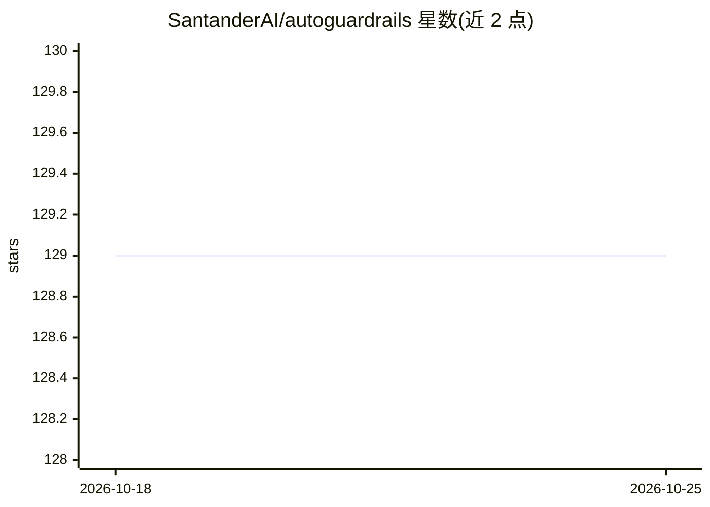

# SantanderAI/autoguardrails

⭐ 129 · Python · Apache-2.0 · 推送 2026-10-01 · [GitHub](https://github.com/SantanderAI/autoguardrails) · [官网](https://github.com/SantanderAI) · 组织维护

**面向研究者的 LLM 护栏策略搜索评测脚手架**

Santander AI Lab 开源的护栏研究库/评测框架，借鉴 autoresearch 思路：固定评测集、judge 提示与 Python 测试装置，仅在单一可变的 policy.md 上做搜索，以攻击成功率（ASR，越低越好）为主线指标，并设良性通过率下限防止靠全部拒答取胜。报告 asr_unguarded/asr_with_policy/policy_delta 与空策略基线。默认使用确定性本地 stub 可离线运行，接 OpenAI 兼容端点可跑真实模型实验；仅限单轮、不建模工具或多步 agent。纯标准库实现，Python 3.10+，Apache 2.0。

## 筛选速览

| 维度 | 判定 | 备注 |
|---|---|---|
| AI 角色 | `ai-ecosystem` | LLM/agent 周边工具 |
| 许可风险 | `permissive` | Apache-2.0 |
| 部署形态 | `None` |  |
| 模型依赖 | — | README 未给出锁定关系 |
| 硬件要求 | — | 无带数字的原话,不猜 |
| 安装摩擦 | `low` | 无编译、无系统依赖或容器化 |
| 成熟度 | — | 结构信号不足 |

## 能力要点

- 固定评测装置，仅搜索单一 policy.md 可变面
- ASR 主指标加良性通过率下限的接受规则（良性通过下降不超过 2 个百分点）
- 报告空策略基线与 policy_delta，区分护栏贡献与模型原生安全性
- 零第三方运行时依赖，默认离线 stub 运行；OpenAI 兼容端点可选接入

## 适用场景

- 研究者在固定评测集上迭代护栏策略并记录每次保留/拒绝决策
- 测量护栏策略对攻击成功率的边际改进（policy_delta）
- 离线验证护栏评测装置后接入真实模型端点复现实验

## 场景标签

`模型评测` `网络安全` · 领域:评测与运维

## 证据(README 行号)

> L3: > **Open source by Santander AI Lab.** An **LLM / AI-safety** guardrail research **library / evaluation harness** (a
> L16: `autoguardrails` is a small alignment research scaffold inspired by Karpathy's `autoresearch`.

## 星数曲线

2026-10-18 129 → 2026-10-25 129（+0）

---
*卡片 v1 · prompt 1.4 · 生成 2026-10-22 · 置信度 high · 依据 README sha `5c267336c9ef` · [字段定义](../../DATASET.md)*
