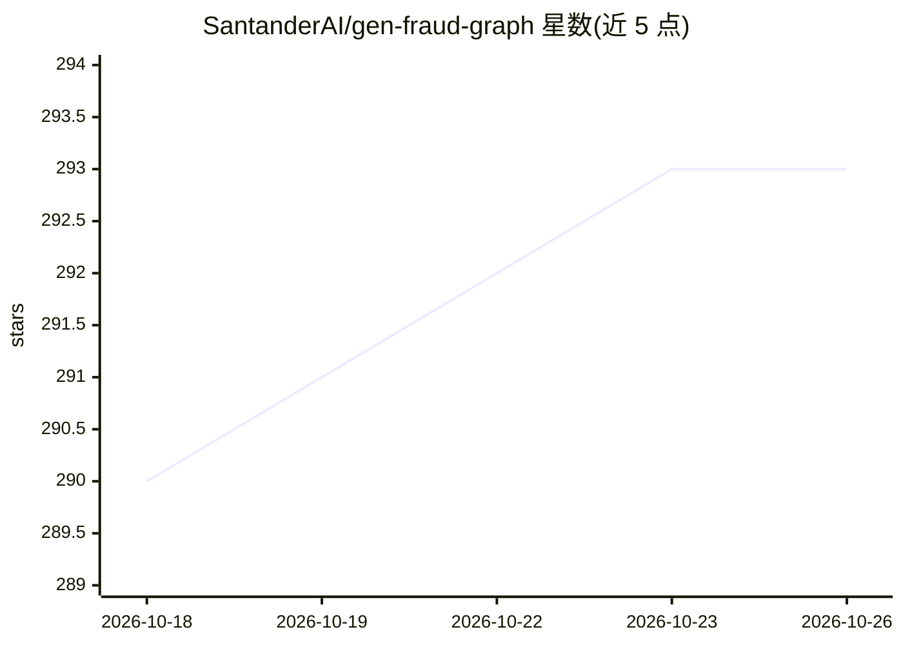

# SantanderAI/gen-fraud-graph

⭐ 293 · Python · Apache-2.0 · 推送 2026-10-01 · [GitHub](https://github.com/SantanderAI/gen-fraud-graph) · [官网](https://pypi.org/project/gen-fraud-graph/) · 组织维护

**面向金融反欺诈的合成交易图生成器，用于训练与基准测试**

Santander AI Lab 开源的 Python 工具，生成大规模合成金融交易图：账户节点、正常交易边与可配置深度（4-7 跳）的循环洗钱欺诈环，支持 1K 到 100M+ 账户规模、多进程并行、断点续跑，输出 CSV（或 Neptune 批量加载格式）供图数据库摄取或训练 GNN。嵌入向量提供 fake/local(SentenceTransformers)/openai 三种可选提供方。所有数据 100% 合成，不含真实金融数据。尚未发布到 PyPI，需从源码安装；要求 Python 3.10+。

## 筛选速览

| 维度 | 判定 | 备注 |
|---|---|---|
| AI 角色 | `ai-ecosystem` | LLM/agent 周边工具 |
| 许可风险 | `permissive` | Apache-2.0 |
| 部署形态 | `library` | 以包/库形式分发 |
| 模型依赖 | — | README 未给出锁定关系 |
| 硬件要求 | — | 无带数字的原话,不猜 |
| 安装摩擦 | `low` | 无编译、无系统依赖或容器化 |
| 成熟度 | — | 结构信号不足 |

## 能力要点

- 生成 1K-100M+ 账户规模的合成金融交易图，支持断点续跑
- 注入可配置深度（4-7 跳）的循环洗钱欺诈环并附标签文件
- 嵌入提供方三种：fake 随机、local SentenceTransformers、openai API
- 输出通用 CSV 或 AWS Neptune 批量加载格式

## 适用场景

- 训练和评估图神经网络反欺诈模型
- 对反洗钱检测算法做基准测试
- 对 TigerGraph/Neptune/Neo4j 等图数据库做加载压测

## 场景标签

`金融量化` · 领域:学习与行业

## 证据(README 行号)

> L19: **gen_fraud_graph** is an open-source Python tool that generates massive synthetic financial transaction graphs wit
> L38: - Training and evaluating **graph neural networks (GNN)** for fraud detection

## 星数曲线

2026-10-18 290 → 2026-10-26 293（+3）

---
*卡片 v1 · prompt 1.4 · 生成 2026-10-22 · 置信度 mid · 依据 README sha `ad7f38bb8e8b` · [字段定义](../../DATASET.md)*
