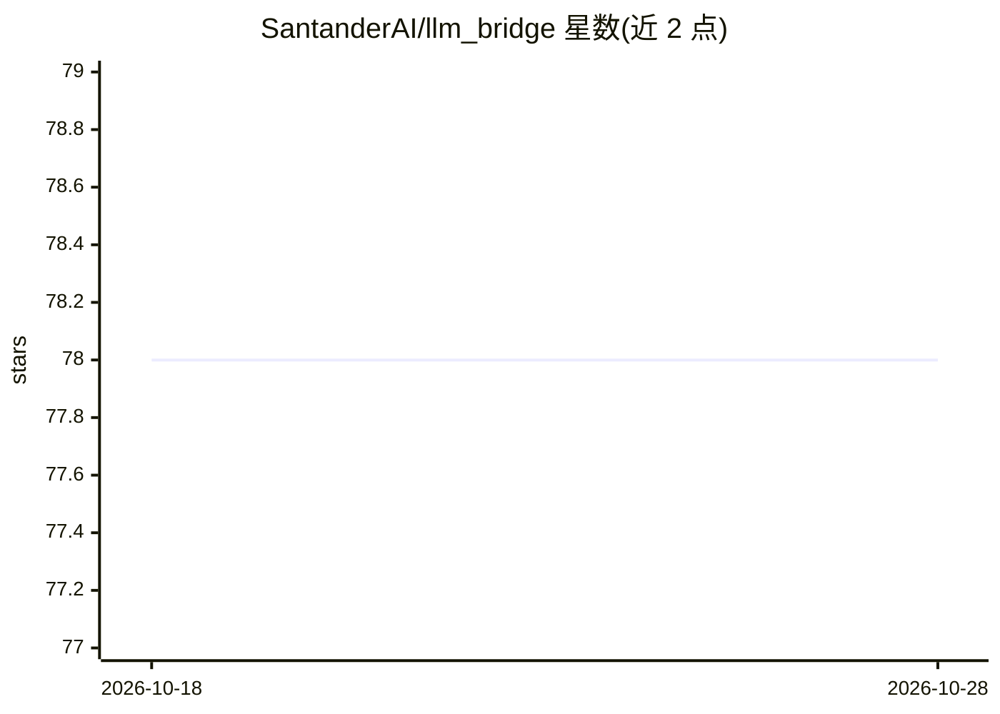

# SantanderAI/llm_bridge

⭐ 78 · Python · Apache-2.0 · 推送 2026-10-01 · [GitHub](https://github.com/SantanderAI/llm_bridge) · [官网](https://github.com/SantanderAI) · 组织维护

**给开发者的厂商中立 LLM 客户端库：统一接口切换多后端**

由 Santander AI Lab 开源的 Python LLM 客户端库：提供 LLMClient 统一接口（chat/complete 返回规范化的 LLMResponse，含内容、token 用量与延迟），通过各厂商官方 SDK 的适配器接入 OpenAI、DeepSeek、阿里通义千问、AWS Bedrock 与 Google Gemini；openai 适配器也可指向任意 OpenAI 兼容端点（vLLM、Ollama、Azure OpenAI 或内部网关）。核心零必装依赖，厂商 SDK 按需以 extras 安装；还提供 mock 与 callable 两个无依赖 provider，后者可包装任意函数接入自有后端。要求 Python 3.9+，Apache 2.0 许可，声明非 Banco Santander 官方产品。

## 筛选速览

| 维度 | 判定 | 备注 |
|---|---|---|
| AI 角色 | `ai-ecosystem` | LLM/agent 周边工具 |
| 许可风险 | `permissive` | Apache-2.0 |
| 部署形态 | `library` | 以包/库形式分发 |
| 模型依赖 | local-ok | 支持本地模型 |
| 硬件要求 | — | 无带数字的原话,不猜 |
| 安装摩擦 | `low` | 无编译、无系统依赖或容器化 |
| 成熟度 | — | 结构信号不足 |

## 能力要点

- 单一 LLMClient 接口，多厂商适配器可插拔切换
- 核心零必装依赖，厂商 SDK 通过 extras 按需安装
- callable provider 包装任意函数接入自有/内部后端
- openai provider 支持任意 OpenAI 兼容端点（vLLM/Ollama/Azure/内部网关）

## 适用场景

- 应用只写一次调用代码，在多个 LLM 厂商间切换
- 用 mock provider 做无需凭证的测试与演示
- 把内部自研模型后端包装进统一的 LLM 调用接口

## 场景标签

`模型网关` · 领域:Agent 开发

## 证据(README 行号)

> L16: A tiny, **vendor-neutral wrapper for any LLM backend**. One small interface,
> L22: - **Canonical interface + thin SDK adapters.** One contract (`LLMClient`) with
> L24:  lifting (retries, streaming, types); llm_bridge just normalises the calls.

## 星数曲线

2026-10-18 78 → 2026-10-28 78（+0）

---
*卡片 v1 · prompt 1.4 · 生成 2026-10-24 · 置信度 high · 依据 README sha `b976faec937a` · [字段定义](../../DATASET.md)*
