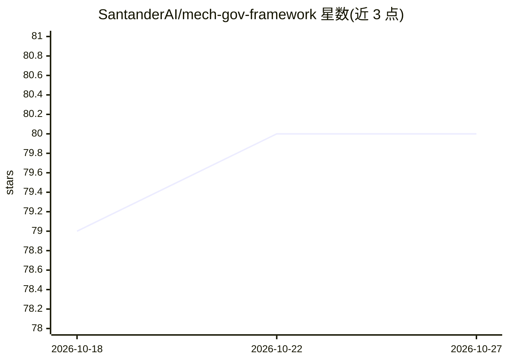

# SantanderAI/mech-gov-framework

⭐ 80 · Python · Apache-2.0 · 推送 2026-10-01 · [GitHub](https://github.com/SantanderAI/mech-gov-framework) · [官网](https://github.com/SantanderAI) · 组织维护

**LLM 高风险决策的机械治理框架：硬门禁与治理度量**

由 Santander AI Lab 开源的模型无关 Python 框架，用于在高风险场景下对 LLM 决策实施与度量治理。实现三种治理机制：文本治理 R1、机械执行 R2（硬门禁、候选冻结、论证质量检查、歧义门、熵 commit–reveal）、自适应 R3。供应商中立：通过 LLMInterface 适配器接入任意后端（callable 封装、OpenAI 兼容端点、可选 bedrock/sagemaker）。提供 CDL/DIU 等治理指标、任务指标（accuracy/F1/MCC）、合成银行决策数据集与 CLI。需 Python 3.10+，非官方 Banco Santander 产品。

## 筛选速览

| 维度 | 判定 | 备注 |
|---|---|---|
| AI 角色 | `ai-ecosystem` | LLM/agent 周边工具 |
| 许可风险 | `permissive` | Apache-2.0 |
| 部署形态 | `library` | 以包/库形式分发 |
| 模型依赖 | local-ok | 支持本地模型 |
| 硬件要求 | — | 无带数字的原话,不猜 |
| 安装摩擦 | `low` | 无编译、无系统依赖或容器化 |
| 成熟度 | — | 结构信号不足 |

## 能力要点

- 三种治理机制 R1（文本）/R2（机械执行）/R3（自适应）
- 熵 commit–reveal 步骤、硬门禁、候选冻结与歧义门
- 治理指标 CDL/DIU/FVS/ESD/FSR/IPI 与任务指标
- 供应商中立，通过适配器接入任意 LLM 后端

## 适用场景

- 高风险 LLM 决策系统上线的治理与合规执行
- 度量 LLM 决策中的装饰性僵局与延迟信息利用
- 对比不同治理机制的效果（R1/R2/R3 实验研究）

## 场景标签

`模型评测` · 领域:评测与运维

## 证据(README 行号)

> L13: A model-agnostic Python **framework** for enforcing and measuring governance on
> L14: LLM decisions in high-stakes settings — mechanical gates, governance metrics and
> L22: > **Vendor-neutral by design.** Nothing in the core depends on a specific cloud

## 星数曲线

2026-10-18 79 → 2026-10-27 80（+1）

---
*卡片 v1 · prompt 1.4 · 生成 2026-10-24 · 置信度 mid · 依据 README sha `4b2738fa7a50` · [字段定义](../../DATASET.md)*
