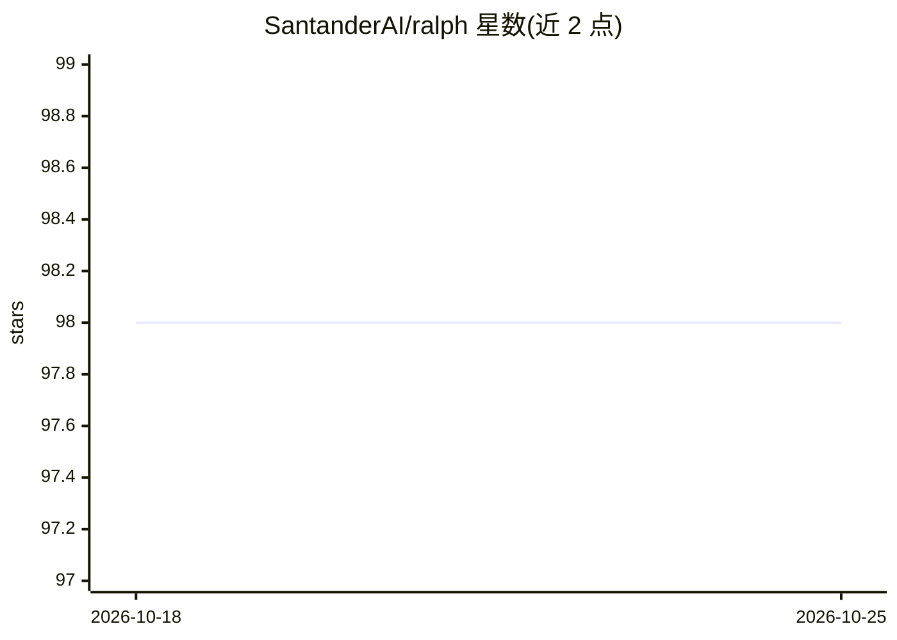

# SantanderAI/ralph

⭐ 98 · PowerShell · Apache-2.0 · 推送 2026-10-03 · [GitHub](https://github.com/SantanderAI/ralph) · [官网](https://github.com/SantanderAI) · 组织维护

**循环驱动 AI 编码 CLI 的 Bash/PowerShell 包装脚本**

由 Santander AI Lab 开源的无依赖 Bash/PowerShell 脚本：以固定提示循环启动已安装的 AI 编码 CLI（Codex、Claude Code、Gemini CLI、Devin CLI），每次迭代均为全新会话，连续性依赖仓库内文件。支持配置热重载（.ralph/.env 每次迭代前重新加载）、stop.md 停止信号、token 耗尽时按 codex→claude→gemini→devin 轮换代理、通过 systemd 用户作用域实施内核级 RAM 上限（默认 8G，超限 OOM-kill）。附带 juez/maestro 两个随项目分发的技能。面向需要长时间无人值守运行编码代理的开发者，要求 Bash 与至少一个受支持 CLI 在 PATH 上。

## 筛选速览

| 维度 | 判定 | 备注 |
|---|---|---|
| AI 角色 | `ai-ecosystem` | LLM/agent 周边工具 |
| 许可风险 | `permissive` | Apache-2.0 |
| 部署形态 | `None` |  |
| 模型依赖 | locked-api |  |
| 硬件要求 | — | 无带数字的原话,不猜 |
| 安装摩擦 | `low` | 无编译、无系统依赖或容器化 |
| 成熟度 | — | 结构信号不足 |

## 能力要点

- 每次迭代启动全新代理会话，工作累积在仓库内
- token 耗尽自动检测并按固定周期轮换代理（codex→claude→gemini→devin）
- systemd 用户作用域实施内核级 RAM 上限，超限 OOM-kill
- 配置热重载与 stop.md 停止信号，代理可自行标记完成

## 适用场景

- 让编码代理长时间无人值守地迭代推进任务
- 代理 token/配额耗尽时自动切换到其他代理继续运行
- 对自主运行中的代理进程施加内存硬限制

## 场景标签

`编码 Agent` · 领域:编码与开发

## 证据(README 行号)

> L15: `ralph` runs an AI coding CLI in a loop, starting a **fresh session on every
> L17: wrapper (`ralph-loop.sh`) around the CLIs you already have installed —
> L45: - At least one of the supported CLIs on your `PATH`: `codex`, `claude`,

## 星数曲线

2026-10-18 98 → 2026-10-25 98（+0）

---
*卡片 v1 · prompt 1.4 · 生成 2026-10-23 · 置信度 high · 依据 README sha `c58ab63f6a03` · [字段定义](../../DATASET.md)*
