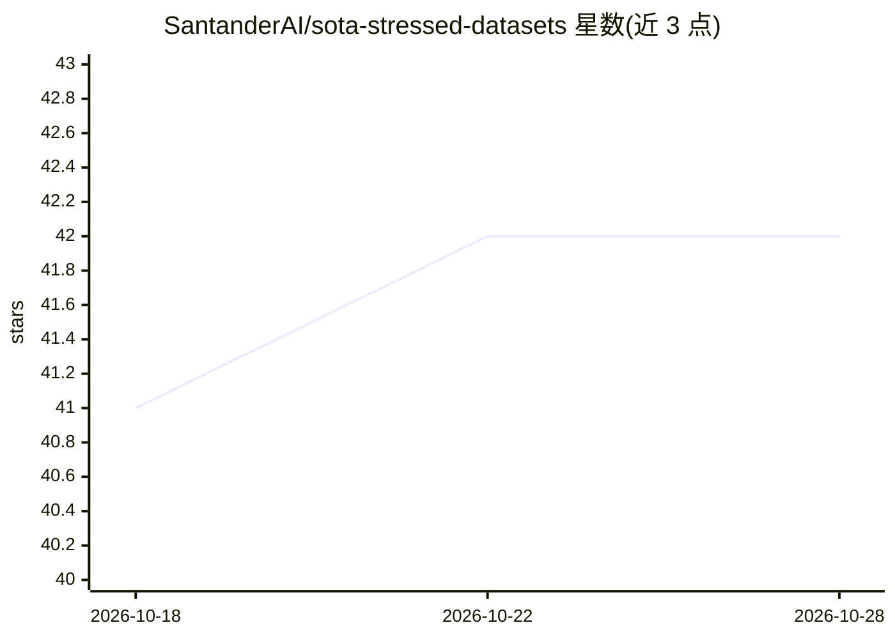

# SantanderAI/sota-stressed-datasets

⭐ 42 · HTML · NOASSERTION · 推送 2026-10-27 · [GitHub](https://github.com/SantanderAI/sota-stressed-datasets) · [官网](https://github.com/SantanderAI) · 组织维护

**发布受控扰动版基准数据集，用于评测 ML/LLM 鲁棒性**

由 Santander AI Lab 维护的数据集集合：将知名公开数据集以受控、有文档记录的输入退化形式（噪声、缺失、歧义、格式变更、矛盾等 shocks 施加于部分记录）重新发布，供社区评估机器学习与 LLM 系统的鲁棒性。目前包含首个数据集 Stressed German Credit（源自 UCI German Credit，版本 SGCD-v0.1）。每个数据集目录自包含，附 README、CHANGELOG、CITATION.cff 与许可证；数据文件由文档化方法再生成而非手工编辑。数据与代码分别采用 CC BY 4.0 与 Apache 2.0。

## 筛选速览

| 维度 | 判定 | 备注 |
|---|---|---|
| AI 角色 | `ai-knowledge` | 知识聚合/清单类 |
| 许可风险 | `none` | NOASSERTION |
| 部署形态 | `None` |  |
| 模型依赖 | — | README 未给出锁定关系 |
| 硬件要求 | — | 无带数字的原话,不猜 |
| 安装摩擦 | `low` | 无编译、无系统依赖或容器化 |
| 成熟度 | — | 结构信号不足 |

## 能力要点

- 对公开基准数据集施加受控且有文档的输入退化（shocks）
- 每个数据集目录自包含，含元数据、变更日志与引用文件
- 数据文件由文档化方法再生成，非手工编辑
- 引用时需同时注明原始数据集与 Santander AI Lab

## 适用场景

- 我要评测模型在噪声、缺失等退化输入下的表现
- 为信用风险模型做压力测试基准
- 复用社区可自由使用的受扰数据集做鲁棒性研究

## 场景标签

`模型评测` · 领域:评测与运维

## 证据(README 行号)

> L7: **Open source by Santander AI Lab.** A benchmark **dataset** collection for evaluating the
> L8: robustness of **machine learning** and **LLM** systems: well-known datasets republished in

## 星数曲线

2026-10-18 41 → 2026-10-28 42（+1）

---
*卡片 v1 · prompt 1.4 · 生成 2026-10-25 · 置信度 high · 依据 README sha `182f6a21729b` · [字段定义](../../DATASET.md)*
