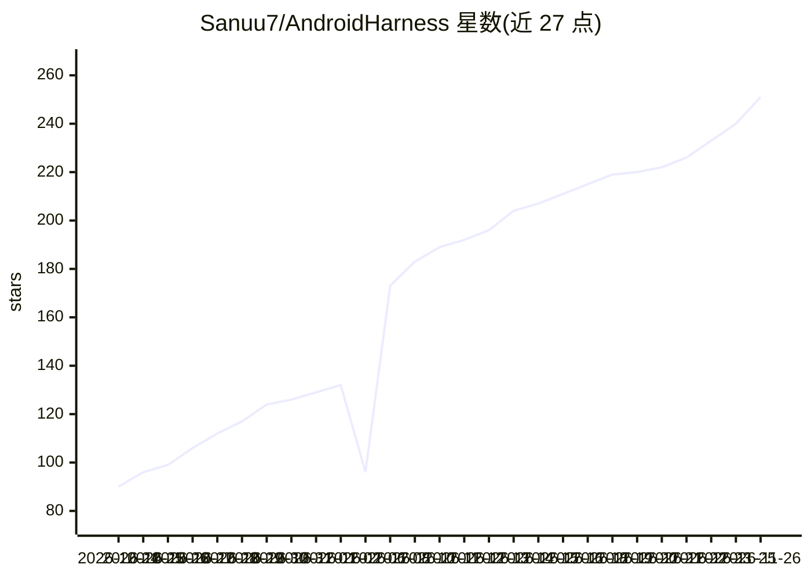

# Sanuu7/AndroidHarness

⭐ 251 · Kotlin · MIT · 推送 2026-11-25 · [GitHub](https://github.com/Sanuu7/AndroidHarness) · [官网](https://androidharness.pages.dev/) · 个人维护

**在 Android 手机上运行的 AI 编程代理与聊天助手应用**

Kotlin + Jetpack Compose 编写的原生 Android 应用，分 Code 与 Chat 两个模块：Code 在项目文件夹内通过文件编辑、shell、git、测试与浏览器工具执行编码任务；Chat 处理日常问答与研究，可移交任务给 Code。shell 通过 Shizuku、Wireless ADB、可选 root 或 Termux Linux 工具链运行；模型可用内置免密 provider、云端 API key 或设备端 GGUF 本地模型离线运行。支持插件、MCP、21 种语言，敏感操作需审批且改动可撤销。

## 筛选速览

| 维度 | 判定 | 备注 |
|---|---|---|
| AI 角色 | `ai-native` | 本体是模型或模型工具 |
| 许可风险 | `permissive` | MIT |
| 部署形态 | `None` |  |
| 模型依赖 | local-ok | 支持本地模型 |
| 硬件要求 | — | 无带数字的原话,不猜 |
| 安装摩擦 | `medium` | 含编译或系统依赖之一 |
| 成熟度 | — | 结构信号不足 |

## 能力要点

- 文件编辑、shell、git、测试、浏览器控制与子代理的完整编码代理工具链
- 内置免密 provider 与设备端 GGUF 模型离线运行
- 11 个搜索 provider 的网页研究流程，读取页面并引用来源
- 插件/skills/MCP 安装管理，命令经 Shizuku/Wireless ADB/Termux 多级 shell 执行

## 适用场景

- 没有 PC 时在手机上修改代码、跑测试并推送到 GitHub
- 用本地模型在离线环境运行编码代理
- 把应用设为数字助理，随时询问当前屏幕内容
- 通过 Chat 做网页研究并获取带引用的答案

## 场景标签

`编码 Agent` `AI 助手` · 领域:编码与开发

## 证据(README 行号)

> L5: **An AI coding agent and chat assistant that runs on your Android phone.**
> L21: AndroidHarness is a native Android app, written in Kotlin with Jetpack Compose, for working on real code projects f
> L28: You can start for free with the built-in provider, which needs no account, or run models fully offline on the devic

## 星数曲线

2026-10-24 90 → 2026-11-26 251（+161）

---
*卡片 v1 · prompt 1.4 · 生成 2026-11-26 · 置信度 high · 依据 README sha `3c6b51611439` · [字段定义](../../DATASET.md)*
