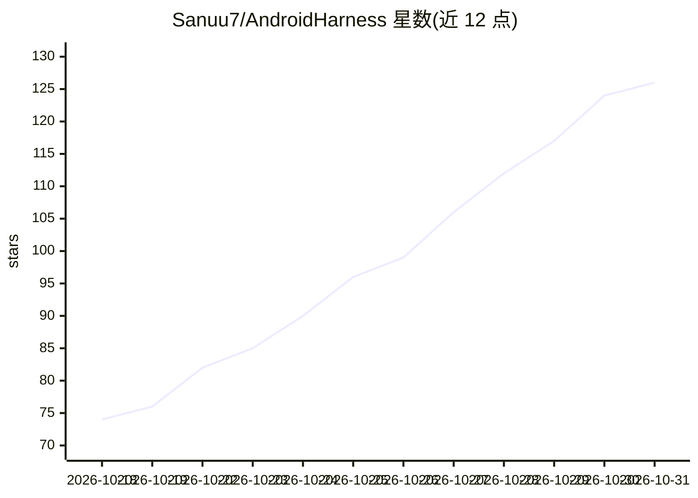

# Sanuu7/AndroidHarness

⭐ 126 · JavaScript · MIT · 推送 2026-10-30 · [GitHub](https://github.com/Sanuu7/AndroidHarness) · [官网](https://androidharness.pages.dev/) · 个人维护 · 中文 README

**安卓手机上的 AI 编程 Agent 原生应用，免 Root 免 PC**

用 Kotlin 与 Jetpack Compose 编写的 Android 原生应用，在手机上直接操作真实代码项目：读写文件、通过 Shizuku/Termux/root/玩具箱运行 bash、git、python、node 命令、推送到 GitHub、控制浏览器，过程以对话流呈现并带工具调用卡片。另有独立 Chat 区处理问答与研究，使用只读网页/GitHub 工具并支持内联引用。内置免注册 keyless 模型，也可用云 API key 或本地 GGUF 模型离线运行。要求 Android 8.0+，Android 11+ 需授予所有文件访问权限。通过 Google Play、GitHub Releases 或源码构建安装。

## 筛选速览

| 维度 | 判定 | 备注 |
|---|---|---|
| AI 角色 | `ai-native` | 本体是模型或模型工具 |
| 许可风险 | `permissive` | MIT |
| 部署形态 | `None` |  |
| 模型依赖 | local-ok | 支持本地模型 |
| 硬件要求 | — | 无带数字的原话,不猜 |
| 安装摩擦 | `medium` | 含编译或系统依赖之一 |
| 成熟度 | — | 结构信号不足 |

## 能力要点

- 手机上读写文件并运行 bash/git/python/node 的真实 Linux 工具链（Shizuku/直连 root/Termux/玩具箱四路）
- 内置 keyless provider 免注册可用，本地 GGUF 模型支持完全离线
- Chat 与 Code 共享一套可审阅记忆，Chat 可通过 Continue in Code 卡片交接项目工作
- 前台服务、恢复卡片与持久消息队列保证长任务跨中断存活；Telegram 远程控制

## 适用场景

- 不带电脑时在安卓手机上完成代码项目的修改、测试与 Git 提交
- 用 Chat 区做带来源引用的日常问答与调研
- 通过 Telegram 远程继续对话、审批工具并回答 Agent 提问

## 场景标签

`编码 Agent` `聊天机器人` · 领域:编码与开发

## 证据(README 行号)

> L16: AndroidHarness is a native Android app, written in Kotlin with Jetpack Compose, that works on real code projects di
> L14: **An AI coding agent and conversation partner that lives on your Android phone.**

## 星数曲线

2026-10-18 74 → 2026-10-31 126（+52）

---
*卡片 v1 · prompt 1.4 · 生成 2026-10-23 · 置信度 high · 依据 README sha `0f623aa88b43` · [字段定义](../../DATASET.md)*
