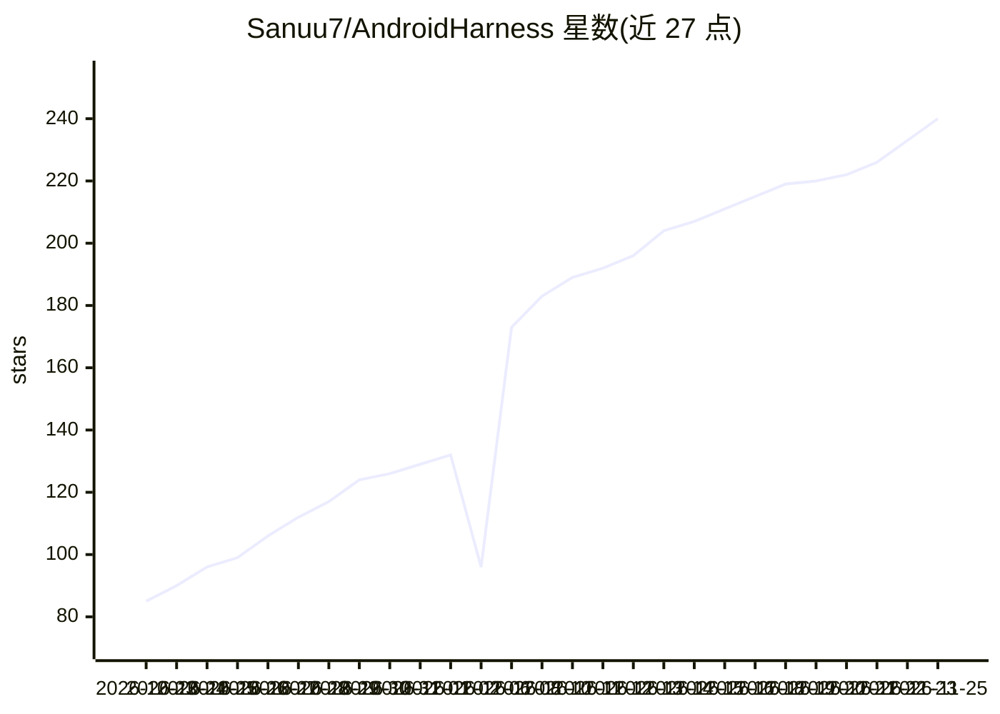

# Sanuu7/AndroidHarness

⭐ 240 · Kotlin · MIT · 推送 2026-11-23 · [GitHub](https://github.com/Sanuu7/AndroidHarness) · [官网](https://androidharness.pages.dev/) · 个人维护

**在 Android 手机上运行的 AI 编码 agent 与聊天助手应用**

Kotlin + Jetpack Compose 编写的原生 Android 应用，分 Code（项目内编码 agent：文件读写、shell、git、测试、浏览器控制、subagent）与 Chat（日常问答与调研）两部分。模型来源包括内置免密 provider、本地 GGUF 离线模型与云端 API。shell 通过 Shizuku/Wireless ADB/root/Termux 工具链分层获取，敏感操作需审批，变更以 diff 呈现可撤销。支持 21 种界面语言，可从 Google Play/GitHub Releases 安装或源码构建。

## 筛选速览

| 维度 | 判定 | 备注 |
|---|---|---|
| AI 角色 | `ai-native` | 本体是模型或模型工具 |
| 许可风险 | `permissive` | MIT |
| 部署形态 | `None` |  |
| 模型依赖 | local-ok | 支持本地模型 |
| 硬件要求 | — | 无带数字的原话,不猜 |
| 安装摩擦 | `medium` | 含编译或系统依赖之一 |
| 成熟度 | — | 结构信号不足 |

## 能力要点

- 手机端编码 agent：文件编辑、shell、git、测试、浏览器与 subagent，工具调用以卡片展示
- 分层 shell 访问：Shizuku、Wireless ADB、可选 root、Termux Linux 工具链与 toybox 回退
- 内置免密 provider 与本地 GGUF 离线模型，云端 API key 可选
- 插件/skill/MCP 支持，npm、GitHub、Claude marketplace 等来源安装

## 适用场景

- 没有电脑时在手机上继续修改和提交代码项目
- 离线场景用本地模型跑聊天与编码任务
- 通过 SSH/FTP 在手机上管理远程工作区并推送 GitHub

## 场景标签

`编码 Agent` `AI 助手` · 领域:编码与开发

## 证据(README 行号)

> L5: **An AI coding agent and chat assistant that runs on your Android phone.**
> L21: AndroidHarness is a native Android app, written in Kotlin with Jetpack Compose, for working on real code projects f
> L25: - **Code** is the agent. It works inside a project folder with files, shell, git, tests and browser tools.

## 星数曲线

2026-10-23 85 → 2026-11-25 240（+155）

---
*卡片 v1 · prompt 1.4 · 生成 2026-11-25 · 置信度 high · 依据 README sha `b4e707d90678` · [字段定义](../../DATASET.md)*
