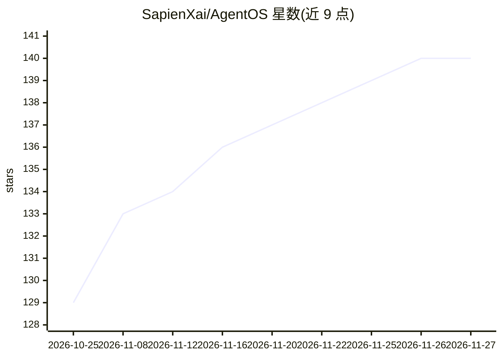

# SapienXai/AgentOS

⭐ 140 · TypeScript · MIT · 推送 2026-11-26 · [GitHub](https://github.com/SapienXai/AgentOS) · [官网](https://agentos.sapienx.app/) · 组织维护

**给运营 AI agent 团队的人提供统一的管理控制台**

AgentOS 是构建于 OpenClaw 之上的开源操作层，把多个 agent 当作数字员工团队来管理：创建工作区与 worker、配置身份/记忆/策略/模型访问、派发即时或定时任务、查看运行记录与 token 用量、通过审批保持人工介入。它不替代 OpenClaw，而是读取其 Gateway 状态并转化为操作界面与诊断；提供 Railway 部署路径、npm/shell 安装的 CLI 及官方 OpenClaw 插件。

## 筛选速览

| 维度 | 判定 | 备注 |
|---|---|---|
| AI 角色 | `ai-ecosystem` | LLM/agent 周边工具 |
| 许可风险 | `permissive` | MIT |
| 部署形态 | `library` | 以包/库形式分发 |
| 模型依赖 | — | README 未给出锁定关系 |
| 硬件要求 | — | 无带数字的原话,不猜 |
| 安装摩擦 | `low` | 无编译、无系统依赖或容器化 |
| 成熟度 | `idea` | |

## 能力要点

- 工作区/worker/任务统一管理，支持即时、定时、周期性派发
- 实时查看任务记录、transcript、token 用量与产出文件
- 接入 Telegram/Discord/Slack 等渠道与浏览器账户
- 提供官方 OpenClaw 插件与 Railway 一键部署模板

## 适用场景

- 把多个 AI agent 组成有分工的数字团队来执行项目
- 需要审批与审计机制控制敏感操作
- 通过一个界面管理多 agent 的模型、任务与健康状态

## 场景标签

`多智能体` · 领域:Agent 开发

## 证据(README 行号)

> L8:  AgentOS is an open-source operating layer for building and running teams of digital workers.
> L263: AgentOS does not replace OpenClaw. OpenClaw is the kernel; AgentOS is the human operating layer above it.
> L11:  Powered by OpenClaw as the agent runtime.

## 星数曲线

2026-10-25 129 → 2026-11-27 140（+11）

---
*卡片 v1 · prompt 1.4 · 生成 2026-11-27 · 置信度 high · 依据 README sha `27adeb1b021e` · [字段定义](../../DATASET.md)*
