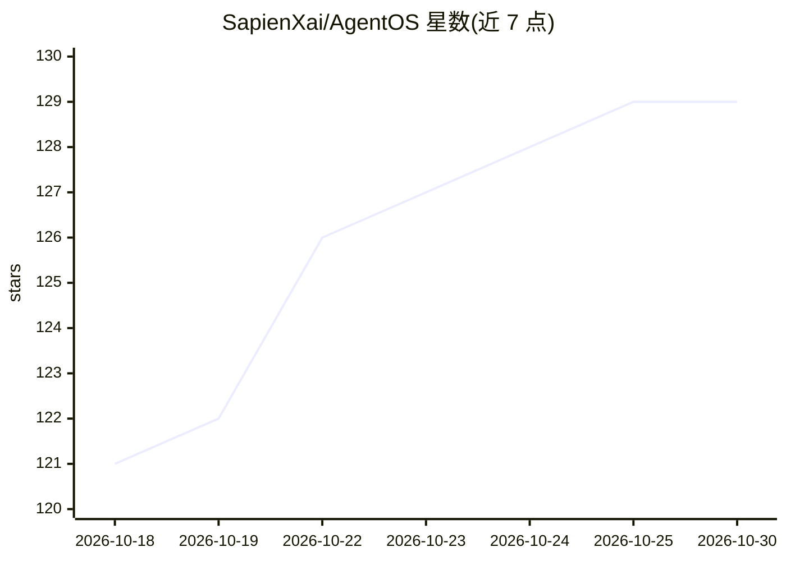

# SapienXai/AgentOS

⭐ 129 · TypeScript · MIT · 推送 2026-10-26 · [GitHub](https://github.com/SapienXai/AgentOS) · [官网](https://agentos.sapienx.app/) · 组织维护

**运行数字员工团队的操作层：基于 OpenClaw 管理 agent、任务与审批**

开源的数字员工操作层，以 OpenClaw 为 agent 运行时内核，在其上提供人员操作界面：创建工作区与 worker、配置身份/模型/心跳/网络策略、分派即时/定时/cron 任务、查看执行状态、transcript、token 用量与产出文件，并提供 Gateway 健康检查、审批与回滚等控制能力。OpenClaw 仍是状态与执行的 source of truth，AgentOS 读取并规范化其状态、把 UI 操作翻译为 Gateway 调用或 CLI 回退。提供安装脚本、npm 包、Railway 部署模板与 OpenClaw 插件。

## 筛选速览

| 维度 | 判定 | 备注 |
|---|---|---|
| AI 角色 | `ai-ecosystem` | LLM/agent 周边工具 |
| 许可风险 | `permissive` | MIT |
| 部署形态 | `library` | 以包/库形式分发 |
| 模型依赖 | — | README 未给出锁定关系 |
| 硬件要求 | — | 无带数字的原话,不猜 |
| 安装摩擦 | `low` | 无编译、无系统依赖或容器化 |
| 成熟度 | — | 结构信号不足 |

## 能力要点

- 以 OpenClaw Gateway 为内核，聚合 worker/任务/模型/上下文/审批的统一操作面
- 任务支持即时、cron、定间隔与一次性未来执行，并展示 transcript、token 用量与产出文件
- Railway 生产导向部署模板（双持久卷、私有 browser-worker、自动密钥）
- 官方 OpenClaw 插件通过 ClawHub 分发，委托规范 AgentOS CLI

## 适用场景

- 把多个 AI agent 组织成有工作区、角色与审批边界的数字团队
- 在一个界面里查看多个 agent 的运行状态、任务历史与输出
- 以定时/cron 方式给数字员工分派周期性工作并保留审计信息

## 场景标签

`多智能体` `工作流自动化` · 领域:Agent 开发

## 证据(README 行号)

> L11:  Powered by OpenClaw as the agent runtime.
> L248: |AgentOS|Organizes workers and workspaces, presents live state, dispatches work, and provides control and diagnost
> L261: AgentOS does not replace OpenClaw. OpenClaw is the kernel; AgentOS is the human operating layer above it.

## 星数曲线

2026-10-18 121 → 2026-10-30 129（+8）

---
*卡片 v1 · prompt 1.4 · 生成 2026-10-23 · 置信度 high · 依据 README sha `69a29d00c2c9` · [字段定义](../../DATASET.md)*
