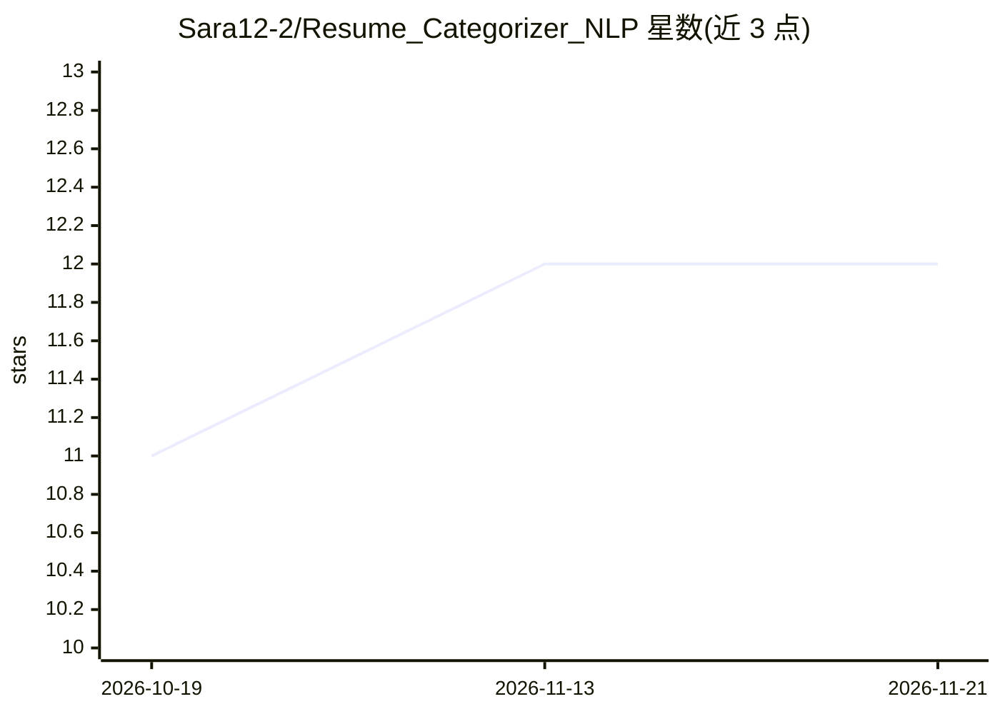

# Sara12-2/Resume_Categorizer_NLP

⭐ 12 · Jupyter Notebook · 推送 2026-07-20 · [GitHub](https://github.com/Sara12-2/Resume_Categorizer_NLP) · 个人维护

**HR/招聘者：NLP+深度学习自动分类简历到职位类别**

基于 Streamlit 的简历分类 Web 应用：用户粘贴简历原文，系统经文本清洗（小写化、去标点、停用词移除、词形还原）、TF-IDF 特征提取（max_features=5000）后，由保存的 Keras 深度学习模型（resume_classifier_model.h5）预测职位类别并展示结果，附带词云可视化。使用 UpdatedResumeDataSet.csv 数据集，模型、TF-IDF 与 LabelEncoder 均持久化复用。目前仅支持文本粘贴输入，PDF/DOCX 上传列为未来计划。

## 筛选速览

| 维度 | 判定 | 备注 |
|---|---|---|
| AI 角色 | `ai-native` | 本体是模型或模型工具 |
| 许可风险 | `none` | — |
| 部署形态 | `None` |  |
| 模型依赖 | — | README 未给出锁定关系 |
| 硬件要求 | — | 无带数字的原话,不猜 |
| 安装摩擦 | `low` | 无编译、无系统依赖或容器化 |
| 成熟度 | — | 结构信号不足 |

## 能力要点

- Keras 深度学习模型对简历文本预测职位类别
- TF-IDF（5000 维）特征提取与文本清洗预处理
- 模型、TF-IDF、LabelEncoder 持久化保存并复用
- Streamlit UI 附词云可视化

## 适用场景

- 把收到的简历按职位领域自动归类
- 演示 NLP 文本分类的完整流程（清洗→向量化→预测）

## 场景标签

 · 领域:人力资源/NLP 文本分类

## 证据(README 行号)

> L3: An AI-based web app to automatically classify resumes into relevant job categories using **Natural Language Processi
> L11: - 🧠 Deep learning classification using Keras
> L39:  - Model predicts category

## 星数曲线

2026-10-19 11 → 2026-11-21 12（+1）

---
*卡片 v1 · prompt 1.4 · 生成 2026-11-18 · 置信度 high · 依据 README sha `663307fb1d52` · [字段定义](../../DATASET.md)*
