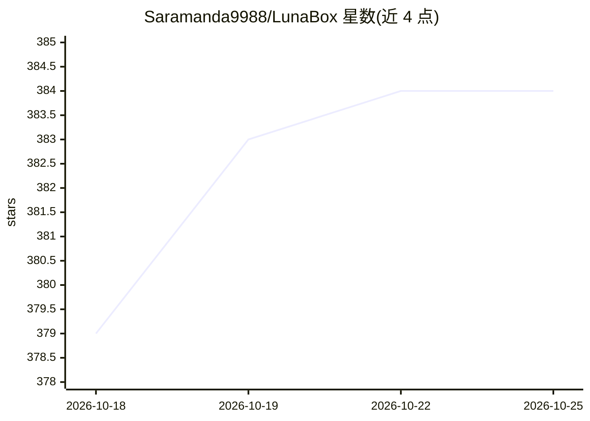

# Saramanda9988/LunaBox

⭐ 384 · Go · AGPL-3.0 · 推送 2026-10-23 · [GitHub](https://github.com/Saramanda9988/LunaBox) · [官网](https://box.lunarain.site) · 个人维护 · 中文 README

**视觉小说/游戏库管理与游玩统计工具，附 AI 数据洞察**

面向 Galgame/视觉小说玩家的本地游戏库管理工具：支持自定义分类、启动时自动记录时长、按日/周/月/年多维度统计并导出分享海报。AI 能力为分析游玩数据生成个性化报告，并通过 MCP 暴露与 CLI skill 供扩展使用。支持从 PotatoVN、Playnite、Vnite、Steam 导入数据，提供本地备份与多设备同步（beta）及 S3/七牛/阿里云 OSS/OneDrive 备份，敏感数据本地存储。基于 Wails v3 构建，从 Releases 下载安装包安装。

## 筛选速览

| 维度 | 判定 | 备注 |
|---|---|---|
| AI 角色 | `ai-enhanced` | 去掉 AI 部分产品仍成立 |
| 许可风险 | `viral` | AGPL-3.0 |
| 部署形态 | `desktop` | 安装包/桌面程序 |
| 模型依赖 | — | README 未给出锁定关系 |
| 硬件要求 | — | 无带数字的原话,不猜 |
| 安装摩擦 | `low` | 无编译、无系统依赖或容器化 |
| 成熟度 | `idea` | |

## 能力要点

- 游戏分类管理与启动时自动游玩时长追踪
- 日/周/月/年多维度统计与可分享统计海报导出
- AI 分析游玩数据生成个性化报告（MCP 暴露与 CLI skill）
- 从 PotatoVN/Playnite/Vnite/Steam 导入，支持 S3 兼容对象存储与 OneDrive 备份

## 适用场景

- 管理我的 Galgame/视觉小说游戏库并分类整理
- 查看游玩时长统计并导出分享海报
- 让 AI 分析游玩数据生成报告

## 场景标签

`数据分析` · 领域:效率与自动化

## 证据(README 行号)

> L17: - **Game category management** - Organize your library with custom categories
> L20: - **AI insights** - Analyze gameplay data to generate personalized, playful reports, with MCP exposure and CLI skil

## 星数曲线

2026-10-18 379 → 2026-10-25 384（+5）

---
*卡片 v1 · prompt 1.4 · 生成 2026-10-21 · 置信度 high · 依据 README sha `658842508f30` · [字段定义](../../DATASET.md)*
