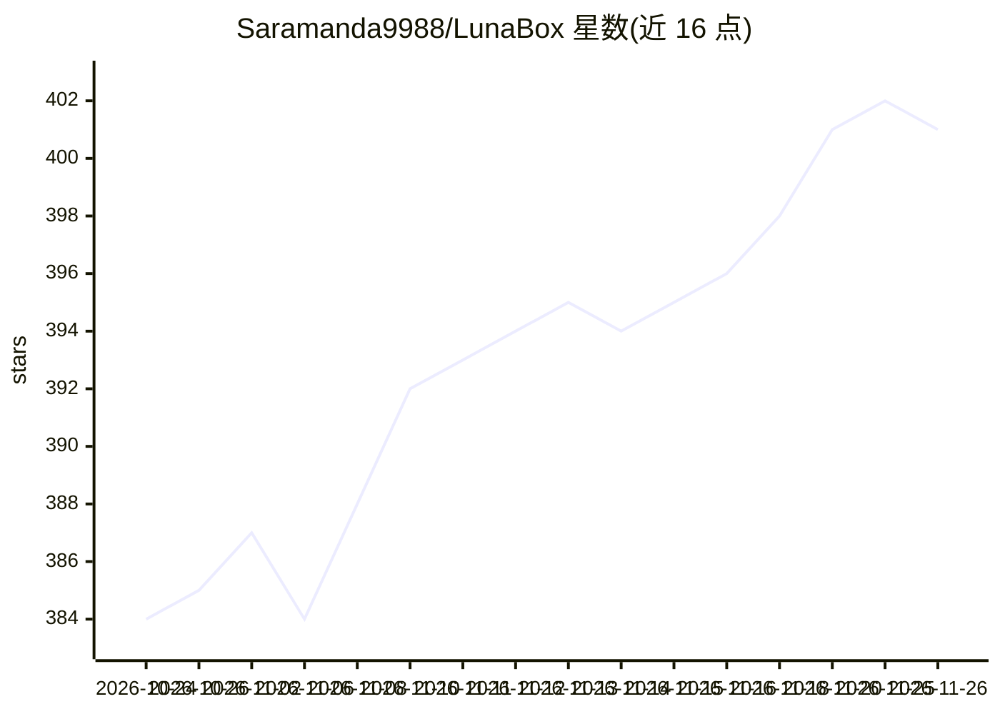

# Saramanda9988/LunaBox

⭐ 401 · Go · AGPL-3.0 · 推送 2026-11-25 · [GitHub](https://github.com/Saramanda9988/LunaBox) · [官网](https://box.lunarain.top) · 个人维护 · 中文 README

**给视觉小说玩家的库管理与游戏时长统计工具，带 AI 报告**

基于 Go 与 MyGo 原生渲染的视觉小说/Galgame 管理工具，提供游戏分类、启动时自动记录会话时长、按日/周/月/年的多维度统计并可导出分享海报。支持从 Playnite、PotatoVN、Vnite、Steam 等导入数据，提供本地备份与 S3/WebDAV/OneDrive 多端同步（beta）、CLI 管理模式；AI 部分为基于游玩数据生成个性化报告，并以 MCP 暴露与 CLI skill 形式支持更多数据使用场景。Windows/macOS/Linux 安装包分发，数据本地存储，AGPL v3 许可。

## 筛选速览

| 维度 | 判定 | 备注 |
|---|---|---|
| AI 角色 | `ai-enhanced` | 去掉 AI 部分产品仍成立 |
| 许可风险 | `viral` | AGPL-3.0 |
| 部署形态 | `desktop` | 安装包/桌面程序 |
| 模型依赖 | — | README 未给出锁定关系 |
| 硬件要求 | — | 无带数字的原话,不猜 |
| 安装摩擦 | `low` | 无编译、无系统依赖或容器化 |
| 成熟度 | — | 结构信号不足 |

## 能力要点

- 自动跟踪游戏会话时长并按日/周/月/年统计，可导出分享海报
- AI 分析游玩数据生成个性化报告，支持 MCP 暴露与 CLI skill
- 从 Playnite、PotatoVN、Vnite、ReinaManager、YukiHub、Steam 导入，支持文件夹批量导入与拖放
- 本地备份与多设备同步（S3 兼容存储、OneDrive、WebDAV）

## 适用场景

- 统一管理我的 Galgame 库并自动记录游玩时长
- 生成年度/月度游玩统计海报分享
- 多设备间同步游戏库数据与备份
- 用 AI 分析我的游玩数据生成报告

## 场景标签

`数据分析` · 领域:效率与自动化

## 证据(README 行号)

> L18: - **Game categories and playtime tracking** - Organize your library with custom categories and automatically track 
> L20: - **AI insights** - Analyze gameplay data to generate personalized, playful reports, with MCP exposure and CLI skil
> L17: - **Native rendering** - The UI is drawn natively by MyGo, lightweight and smooth, on Windows, macOS, and Linux

## 星数曲线

2026-10-24 384 → 2026-11-26 401（+17）

---
*卡片 v1 · prompt 1.4 · 生成 2026-11-25 · 置信度 high · 依据 README sha `d4a4796010fb` · [字段定义](../../DATASET.md)*
