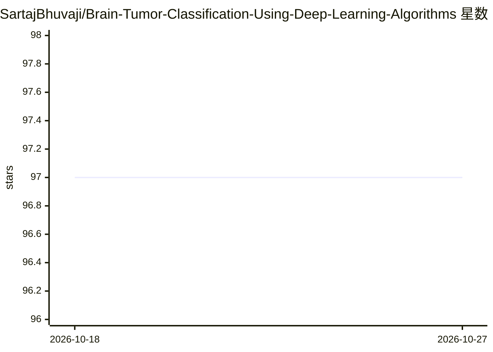

# SartajBhuvaji/Brain-Tumor-Classification-Using-Deep-Learning-Algorithms

⭐ 97 · Jupyter Notebook · 推送 2025-11-08 · [GitHub](https://github.com/SartajBhuvaji/Brain-Tumor-Classification-Using-Deep-Learning-Algorithms) · [官网](https://sartajbhuvaji.github.io/Brain-Tumor-Classification-Website/) · 组织维护

**用 ANN/CNN/迁移学习对 MRI 脑瘤做分类的深度学习项目**

基于 SPPU 的学生/团队深度学习项目：在 3260 张 T1 加权对比增强 MRI 图像（Kaggle 数据集，经清洗与增广）上，比较 ANN、CNN 与迁移学习（VGG16 微调）模型，识别脑瘤并分类为良性、恶性或垂体瘤三类。报告最佳 CNN（3 层卷积）准确率 90%，VGG16 微调验证准确率 94%、F1 为 91。以 Colab 笔记本形式提供（Open In Colab），附论文引用与相关数据集仓库；README 未列出本地安装命令，仅标注 Python 3.7。

## 筛选速览

| 维度 | 判定 | 备注 |
|---|---|---|
| AI 角色 | `ai-native` | 本体是模型或模型工具 |
| 许可风险 | `none` | — |
| 部署形态 | `None` |  |
| 模型依赖 | — | README 未给出锁定关系 |
| 硬件要求 | — | 无带数字的原话,不猜 |
| 安装摩擦 | `low` | 无编译、无系统依赖或容器化 |
| 成熟度 | — | 结构信号不足 |

## 能力要点

- 比较 ANN、CNN、VGG16 迁移学习三类模型
- 3260 张 T1 加权 MRI 图像数据集，分类良性/恶性/垂体瘤三类
- VGG16 微调验证准确率 94%，F1-Score 91
- 附 2021 年期刊论文引用与 Kaggle 数据集

## 适用场景

- 参考脑瘤 MRI 分类的模型比较实验方案
- 在 Colab 中直接运行脑瘤分类训练/评估代码
- 获取经清洗与增广的脑瘤 MRI 数据集入口

## 场景标签

`目标检测` · 领域:感知与多模态

## 证据(README 行号)

> L19:  To Detect and Classify Brain Tumors using CNN and TL.
> L27: In this project, we propose comparative studies of various deep learning models based on different types of Neural 

## 星数曲线

2026-10-18 97 → 2026-10-27 97（+0）

---
*卡片 v1 · prompt 1.4 · 生成 2026-10-23 · 置信度 high · 依据 README sha `1e0c285009c0` · [字段定义](../../DATASET.md)*
