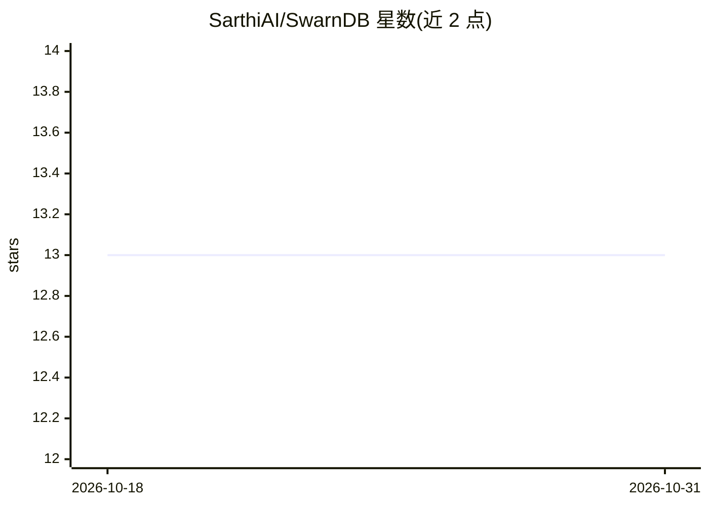

# SarthiAI/SwarnDB

⭐ 13 · Rust · NOASSERTION · 推送 2026-06-16 · [GitHub](https://github.com/SarthiAI/SwarnDB) · 组织维护

**融合向量检索与类型化图的 Rust 数据库引擎，面向 RAG/GraphRAG**

Rust 编写的存储引擎，将向量与图节点统一为同一对象（同一 id、同一存储与恢复路径），无需在向量库与图库之间同步。默认提供基于 HNSW 的 ANN 检索（4 种距离度量、SQ8/IVF+PQ 量化、元数据预过滤），集合切换 hybrid 模式后可存储带置信度与溯源记录的有向类型化边，执行向量相似度、k-hop 遍历、最短路径组合查询；可选 BYOK 接入 OpenAI 兼容模型抽取实体与边。提供 gRPC 与 REST 双 API、WAL 崩溃恢复、Docker 镜像与 Python SDK。macOS 仅构建 Apple Silicon wheel，Windows 仅 x86_64。

## 筛选速览

| 维度 | 判定 | 备注 |
|---|---|---|
| AI 角色 | `ai-ecosystem` | LLM/agent 周边工具 |
| 许可风险 | `none` | NOASSERTION |
| 部署形态 | `self-host` | docker 或自建部署 |
| 模型依赖 | — | README 未给出锁定关系 |
| 硬件要求 | — | 无带数字的原话,不猜 |
| 安装摩擦 | `low` | 无编译、无系统依赖或容器化 |
| 成熟度 | — | 结构信号不足 |

## 能力要点

- 向量 id 与图节点 id 同一，单一引擎内组合相似度与图遍历查询
- HNSW + SQ8/IVF+PQ 量化、元数据预过滤、15+ 向量数学运算
- 可选 BYOK 的 LLM 实体/边抽取，带置信度与溯源记录及 verify/reject 环路
- WAL 崩溃安全、Prometheus 指标、gRPC 与 REST 双 API

## 适用场景

- RAG/GraphRAG 场景中同时做语义检索与知识图谱遍历
- 替代向量库+图库双系统组合，避免数据同步
- 带属性约束的精确 top-k 过滤检索

## 场景标签

`向量数据库` `知识图谱` · 领域:知识与检索

## 证据(README 行号)

> L5:  The vector database that thinks in graphs.
> L16: SwarnDB removes the seam. It is a production-grade engine, written in Rust, where **a vector and a graph node are t
> L48: **Optional LLM-driven extraction: bring your own key.**

## 星数曲线

2026-10-18 13 → 2026-10-31 13（+0）

---
*卡片 v1 · prompt 1.4 · 生成 2026-10-31 · 置信度 high · 依据 README sha `fe43fc80f90e` · [字段定义](../../DATASET.md)*
