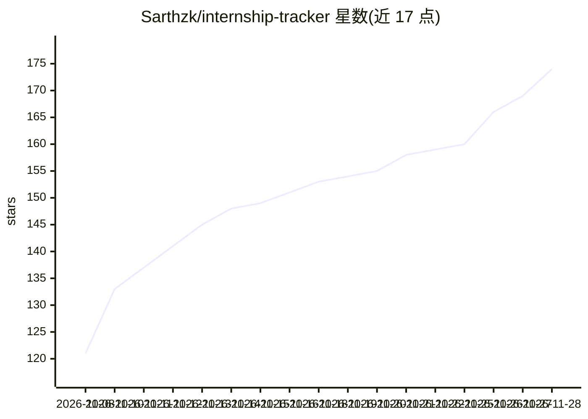

# Sarthzk/internship-tracker

⭐ 174 · Python · NOASSERTION · 推送 2026-11-27 · [GitHub](https://github.com/Sarthzk/internship-tracker) · [官网](https://t.me/tech_internships) · 个人维护

**印度科技实习自动追踪清单：160+ 公司官网聚合+Telegram 通知**

通过 GitHub Actions 定时抓取 160+ 公司（Google、Microsoft、Amazon、Nvidia 等）官方招聘页，筛选印度地区技术实习岗位，与上次结果对比后将新职位写入 data/listings.json 并重新生成 README；无服务器、无数据库，仓库本身即数据库。提供 Telegram 频道 t.me/tech_internships 推送提醒，90 天内关闭的职位归档于 README-archive.md，各公司监测健康状态记录在 STATUS.md。声明为非官方社区项目，提醒用户以公司官网为准。

## 筛选速览

| 维度 | 判定 | 备注 |
|---|---|---|
| AI 角色 | `ai-knowledge` | 知识聚合/清单类 |
| 许可风险 | `none` | NOASSERTION |
| 部署形态 | `None` |  |
| 模型依赖 | — | README 未给出锁定关系 |
| 硬件要求 | — | 无带数字的原话,不猜 |
| 安装摩擦 | `low` | 无编译、无系统依赖或容器化 |
| 成熟度 | — | 结构信号不足 |

## 能力要点

- GitHub Actions 定时抓取 160+ 公司官方招聘页并对比增量
- 无服务器无数据库架构，data/listings.json 作为数据存储
- Telegram 频道推送新岗位提醒
- 按 Software Engineering/Data & ML/Hardware 等类别组织，附关闭职位归档与健康状态文件

## 适用场景

- 印度学生找科技公司技术实习岗位
- 订阅 Telegram 获取新实习岗位提醒
- 查看特定公司（大厂/银行/初创）的实习开放情况

## 场景标签

`网页抓取` `工作流自动化` · 领域:效率与自动化

## 证据(README 行号)

> L3: An automatically updated list of **tech internships in India** (and remote-India) from the career
> L10: A GitHub Actions job checks each company's official career page on a schedule, keeps only
> L12: New postings are saved to `data/listings.json` and this page is regenerated.

## 星数曲线

2026-11-08 121 → 2026-11-28 174（+53）

---
*卡片 v1 · prompt 1.4 · 生成 2026-11-28 · 置信度 high · 依据 README sha `5e1485518cd4` · [字段定义](../../DATASET.md)*
