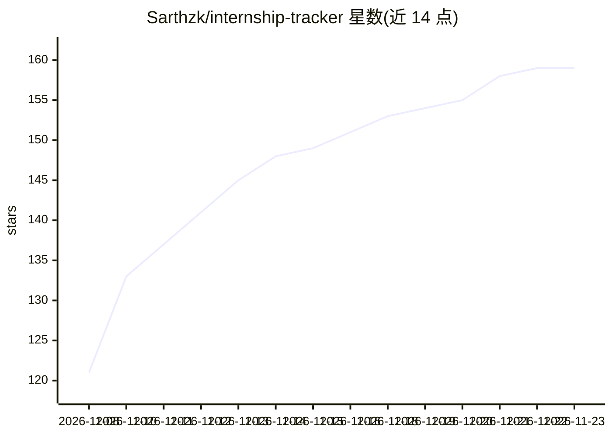

# Sarthzk/internship-tracker

⭐ 159 · Python · NOASSERTION · 推送 2026-11-22 · [GitHub](https://github.com/Sarthzk/internship-tracker) · [官网](https://t.me/tech_internships) · 个人维护

**自动追踪印度科技实习岗位的清单仓库，附 Telegram 提醒**

一个由 GitHub Actions 定时任务驱动的印度科技实习岗位聚合仓库：抓取 160+ 家公司官方招聘页（Google、Microsoft、Nvidia、高盛等），仅保留印度境内技术类实习，与上次结果对比后将新岗位写入 data/listings.json 并重新生成本页面。无服务器、无数据库，仓库本身即数据源。岗位按软件工程、Data & ML、量化、硬件、产品等分类展示，附公司类型标签与发布天数；近 90 天已关闭岗位归档于 README-archive.md，各公司追踪健康状态见 STATUS.md。通过 Telegram 频道推送新岗位，链接始终指向公司官方招聘页，声明为非官方社区项目、非完整列表。

## 筛选速览

| 维度 | 判定 | 备注 |
|---|---|---|
| AI 角色 | `ai-knowledge` | 知识聚合/清单类 |
| 许可风险 | `none` | NOASSERTION |
| 部署形态 | `None` |  |
| 模型依赖 | — | README 未给出锁定关系 |
| 硬件要求 | — | 无带数字的原话,不猜 |
| 安装摩擦 | `low` | 无编译、无系统依赖或容器化 |
| 成熟度 | — | 结构信号不足 |

## 能力要点

- 定时抓取 160+ 公司官方招聘页，仅保留印度技术类实习
- 无服务器无数据库，仓库即数据源（GitHub Actions 驱动）
- Telegram 频道推送新岗位提醒
- 90 天归档（README-archive.md）与各公司追踪健康状态（STATUS.md）

## 适用场景

- 印度学生集中查看多家大厂与初创的技术实习 openings
- 通过 Telegram 订阅新实习岗位提醒
- 查看近期已关闭岗位与各公司招聘页追踪状态

## 场景标签

`精选清单` · 领域:学习与行业

## 证据(README 行号)

> L10: A GitHub Actions job checks each company's official career page on a schedule, keeps only
> L12: New postings are saved to `data/listings.json` and this page is regenerated.

## 星数曲线

2026-11-08 121 → 2026-11-23 159（+38）

---
*卡片 v1 · prompt 1.4 · 生成 2026-11-17 · 置信度 low · 依据 README sha `f317ed88edb1` · [字段定义](../../DATASET.md)*
