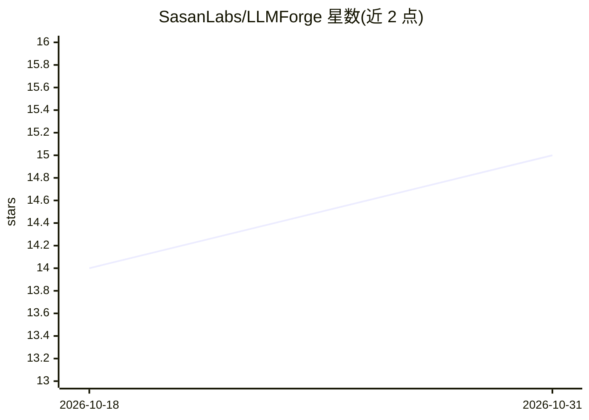

# SasanLabs/LLMForge

⭐ 15 · Python · Apache-2.0 · 推送 2026-10-23 · [GitHub](https://github.com/SasanLabs/LLMForge) · 组织维护

**面向 LLM 安全攻防训练的故意脆弱实验环境（真实本地 LLM 驱动）**

OWASP VulnerableApp 生态的 AI/LLM 漏洞模块：一个故意脆弱的 FastAPI 应用，通过 Ollama 接入本地真实运行的 LLM（非模拟应答），提供提示注入、间接提示注入、LLM 编排 BOLA、RAG 上下文投毒与 RAG 敏感数据泄露五类实验，共 24 个渐进式关卡，映射 OWASP LLM/API 风险编号。关卡以装饰器框架声明式定义并自动生成关卡 UI。以 docker compose 一键启动，供安全学习与防御研究使用。

## 筛选速览

| 维度 | 判定 | 备注 |
|---|---|---|
| AI 角色 | `ai-ecosystem` | LLM/agent 周边工具 |
| 许可风险 | `permissive` | Apache-2.0 |
| 部署形态 | `self-host` | docker 或自建部署 |
| 模型依赖 | local-ok | 支持本地模型 |
| 硬件要求 | — | 无带数字的原话,不猜 |
| 安装摩擦 | `low` | 无编译、无系统依赖或容器化 |
| 成熟度 | — | 结构信号不足 |

## 能力要点

- 5 类漏洞实验、24 个渐进式关卡，映射 OWASP LLM01/LLM04/BOLA 等编号
- 所有关卡对接 Ollama 本地真实 LLM，无预置/模拟应答
- @vulnerable_llm_controller 等装饰器声明式定义关卡，自动生成 UI 与漏洞清单
- 可配置聊天/嵌入模型（默认 phi3:mini / nomic-embed-text）

## 适用场景

- 安全学习者实践提示注入与 RAG 攻击手法
- 开发者在脆弱样例上验证 LLM 防护与访问控制的改进效果
- 教学场景演示 LLM 集成系统的典型失效模式

## 场景标签

`网络安全` · 领域:学习与行业

## 证据(README 行号)

> L4: **LLMForge is the AI/LLM vulnerability module of OWASP VulnerableApp.**
> L6: It's a deliberately vulnerable FastAPI application that plugs into the existing VulnerableApp-facade ecosystem — the
> L10: Static, code-only vulnerable apps can't teach you how LLM-integrated systems fail. LLMForge fills that gap: each la

## 星数曲线

2026-10-18 14 → 2026-10-31 15（+1）

---
*卡片 v1 · prompt 1.4 · 生成 2026-10-31 · 置信度 high · 依据 README sha `5118124581a2` · [字段定义](../../DATASET.md)*
