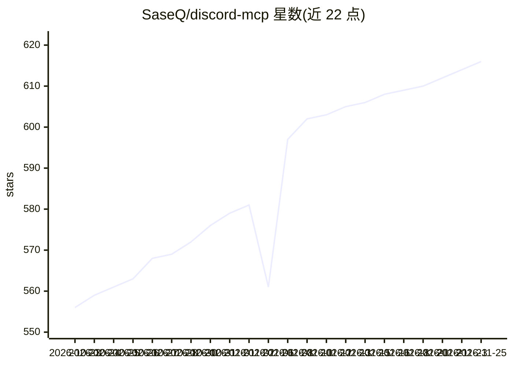

# SaseQ/discord-mcp

⭐ 616 · Java · MIT · 推送 2026-10-23 · [GitHub](https://github.com/SaseQ/discord-mcp) · 个人维护

**让 AI 助手通过 MCP 协议操作 Discord 的 Java 服务器**

基于 JDA 实现的 Discord MCP 服务器，将 Discord API 封装为约 70 个 MCP 工具，覆盖服务器信息、用户/消息/频道/分类/Webhook/角色/管理操作/语音与舞台频道/定时活动/频道权限/邀请/线程等管理。支持 HTTP 与 stdio 两种传输模式，提供 Docker、Docker Compose 与 Maven 手动构建三种部署方式，并给出 Claude Code、Codex CLI、OpenClaw、Cursor、n8n、Claude Desktop 等客户端的接入配置。使用需自建 Discord 机器人并配置 token。

## 筛选速览

| 维度 | 判定 | 备注 |
|---|---|---|
| AI 角色 | `ai-ecosystem` | LLM/agent 周边工具 |
| 许可风险 | `permissive` | MIT |
| 部署形态 | `self-host` | docker 或自建部署 |
| 模型依赖 | — | README 未给出锁定关系 |
| 硬件要求 | — | 无带数字的原话,不猜 |
| 安装摩擦 | `low` | 无编译、无系统依赖或容器化 |
| 成熟度 | — | 结构信号不足 |

## 能力要点

- 约 70 个 Discord 管理 MCP 工具，覆盖消息、频道、角色、活动、权限等
- 支持 HTTP（默认 8085 端口）与 stdio 两种传输模式
- 提供 Docker、Docker Compose、Maven 源码构建三种部署方式
- 附带 Claude Code/Codex/OpenClaw/Cursor/n8n/Claude Desktop 接入配置

## 适用场景

- 让 AI 助手代为管理 Discord 服务器的频道、角色与成员
- 在 n8n 工作流中通过 MCP 客户端节点调用 Discord 工具
- 通过自然语言完成封禁、超时、邀请链接等服务器管理操作

## 场景标签

 · 领域:AI 生态/MCP 服务器

## 证据(README 行号)

> L17: A Model Context Protocol (MCP) server for the Discord API using (JDA),
> L18: designed to integrate Discord bots with MCP-compatible applications such as Claude, ChatGPT etc. It allows AI assis
> L21: ## 🔬 Installation

## 星数曲线

2026-10-23 556 → 2026-11-25 616（+60）

---
*卡片 v1 · prompt 1.4 · 生成 2026-11-25 · 置信度 high · 依据 README sha `5471fd229559` · [字段定义](../../DATASET.md)*
