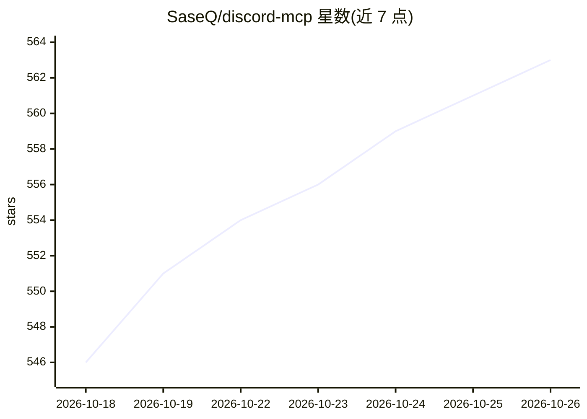

# SaseQ/discord-mcp

⭐ 563 · Java · MIT · 推送 2026-10-23 · [GitHub](https://github.com/SaseQ/discord-mcp) · 个人维护

**给 AI 助手的 Discord MCP 服务器：让客户端操作 Discord 服务器**

基于 Java（JDA）和 Spring 实现的 Discord MCP 服务器，通过 HTTP（默认 localhost:8085/mcp）或 legacy stdio 两种模式供 Claude Desktop、Claude Code、Codex CLI、OpenClaw、Cursor、n8n 等 MCP 客户端接入。暴露约 70 个工具，覆盖消息读写与编辑、频道/分类/角色管理、成员管理与审核（踢/禁/超时）、私信、Webhook、语音频道、定时活动、权限覆写、邀请、论坛帖与表情管理等。提供 Docker 与 Docker Compose 部署，也可 Maven 构建后以 java -jar 运行；需 Discord bot token。

## 筛选速览

| 维度 | 判定 | 备注 |
|---|---|---|
| AI 角色 | `ai-ecosystem` | LLM/agent 周边工具 |
| 许可风险 | `permissive` | MIT |
| 部署形态 | `self-host` | docker 或自建部署 |
| 模型依赖 | locked-api |  |
| 硬件要求 | — | 无带数字的原话,不猜 |
| 安装摩擦 | `low` | 无编译、无系统依赖或容器化 |
| 成熟度 | — | 结构信号不足 |

## 能力要点

- 约 70 个 Discord 工具：消息/频道/角色/审核/私信/Webhook/论坛等
- HTTP 单例与 legacy stdio 两种 MCP 模式，默认端口 8085
- 覆盖 Claude Desktop/Code、Codex CLI、OpenClaw、Cursor、n8n 六类客户端接入配置
- Docker 与 Docker Compose 一键部署，含健康检查端点

## 适用场景

- 让 Claude/Cursor 等 MCP 客户端在我的 Discord 服务器里收发消息、管理频道
- 在 n8n 工作流中通过 MCP Client 节点调用 Discord 自动化工具
- 构建 AI 驱动的 Discord 审核、活动管理与论坛运营流程

## 场景标签

`工作流自动化` · 领域:效率与自动化

## 证据(README 行号)

> L17: A Model Context Protocol (MCP) server for the Discord API using (JDA),
> L18: designed to integrate Discord bots with MCP-compatible applications such as Claude, ChatGPT etc. It allows AI assis

## 星数曲线

2026-10-18 546 → 2026-10-26 563（+17）

---
*卡片 v1 · prompt 1.4 · 生成 2026-10-21 · 置信度 high · 依据 README sha `09e9472c45eb` · [字段定义](../../DATASET.md)*
