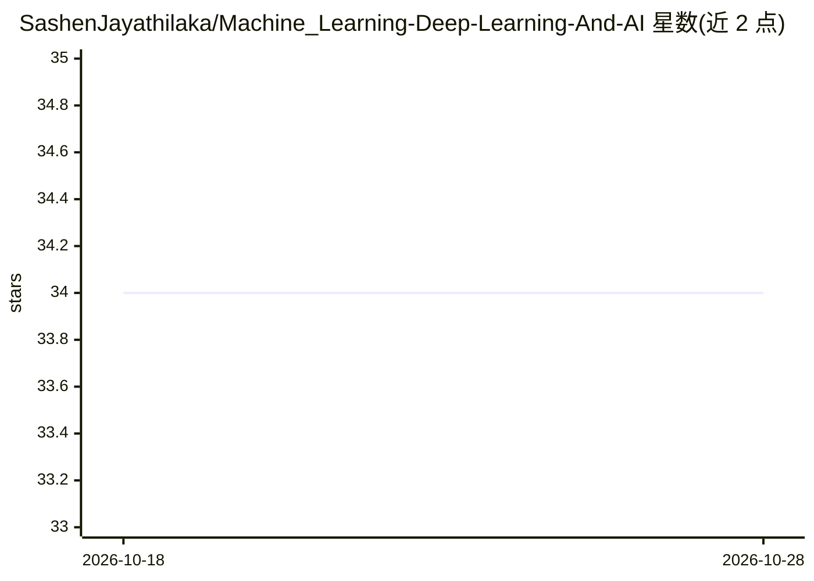

# SashenJayathilaka/Machine_Learning-Deep-Learning-And-AI

⭐ 34 · Jupyter Notebook · 推送 2026-01-01 · [GitHub](https://github.com/SashenJayathilaka/Machine_Learning-Deep-Learning-And-AI) · 个人维护

**Django 建站与 Python 机器学习的个人学习笔记仓库**

个人学习/教学性质仓库，分节记录 Python 基础、Excel 数据处理相关库安装、Django 建站流程（startproject、runserver、migrate）以及基于 OpenCV Haar 级联数据的人脸检测 App。README 以安装命令与外部链接（PyPI、Kaggle、SQLite Browser、OpenCV haarcascades 数据）为主，未提供完整可运行的项目入口或部署说明，属于知识记录而非成品应用。

## 筛选速览

| 维度 | 判定 | 备注 |
|---|---|---|
| AI 角色 | `ai-knowledge` | 知识聚合/清单类 |
| 许可风险 | `none` | — |
| 部署形态 | `library` | 以包/库形式分发 |
| 模型依赖 | — | README 未给出锁定关系 |
| 硬件要求 | — | 无带数字的原话,不猜 |
| 安装摩擦 | `low` | 无编译、无系统依赖或容器化 |
| 成熟度 | — | 结构信号不足 |

## 能力要点

- 记录 Django 建站流程命令（startproject/runserver/migrate）
- 罗列爬虫、Excel、机器学习常用 Python 包安装命令
- 含基于 OpenCV 的人脸检测 App 章节

## 适用场景

- 学习 Django 建站的基础流程
- 查找常见 Python 数据处理与机器学习库的安装命令

## 场景标签

`教程课程` · 领域:学习与行业

## 证据(README 行号)

> L1: # Building a Website with Django
> L47: #### Building a Website with Django
> L70: #### Face_Detector_App

## 星数曲线

2026-10-18 34 → 2026-10-28 34（+0）

---
*卡片 v1 · prompt 1.4 · 生成 2026-10-25 · 置信度 mid · 依据 README sha `efa74fd64864` · [字段定义](../../DATASET.md)*
