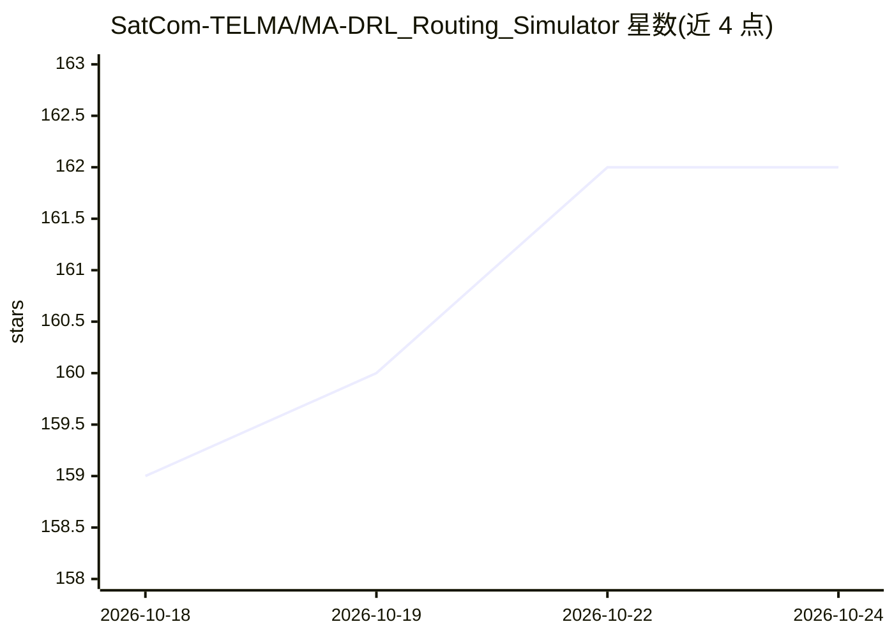

# SatCom-TELMA/MA-DRL_Routing_Simulator

⭐ 162 · Jupyter Notebook · 推送 2026-05-31 · [GitHub](https://github.com/SatCom-TELMA/MA-DRL_Routing_Simulator) · 组织维护

**卫星星座路由仿真器：用多智能体深度强化学习评估路由时延**

基于 Simpy 离散事件仿真的卫星网络数据传输仿真工具：模拟数据块经卫星星座从源网关到目的网关的传播，支持 Dijkstra 最短路径（dataRate/latency/slant_range/hop 度量）与 Q-Learning、Deep Q-Learning 两类路由策略，实现 Kepler、Iridium_NEXT、OneWeb、Starlink 星座，保存遥测数据并通过 Jupyter notebook 做后处理。面向卫星通信研究者，需 Python 3.9（推荐 3.9.12），配有 IEEE TCOM 论文与 Zenodo 仿真器论文，README 列出两个已知问题。

## 筛选速览

| 维度 | 判定 | 备注 |
|---|---|---|
| AI 角色 | `ai-native` | 本体是模型或模型工具 |
| 许可风险 | `none` | — |
| 部署形态 | `library` | 以包/库形式分发 |
| 模型依赖 | — | README 未给出锁定关系 |
| 硬件要求 | — | 无带数字的原话,不猜 |
| 安装摩擦 | `low` | 无编译、无系统依赖或容器化 |
| 成熟度 | — | 结构信号不足 |

## 能力要点

- Simpy 离散事件仿真模拟数据块在星座中的传播与排队
- 支持 Q-Learning 与 Deep Q-Learning 路由及 Dijkstra 基线
- 实现 Kepler、Iridium_NEXT、OneWeb、Starlink 四种星座
- 遥测数据保存为 numpy 数组，附 Post-Results 后处理 notebook

## 适用场景

- 对比强化学习与传统最短路由在卫星网络中的时延表现
- 复现星座路由研究的仿真实验与遥测分析
- 记录并分析星间链路与星地链路的数据速率

## 场景标签

`强化学习` `科研工具` · 领域:学习与行业

## 证据(README 行号)

> L1: # Multi-Agent Deep Reinforcement Learning (MA-DRL) Routing Simulator for satellite networks
> L54: * The "SimulationRL.py" file is for simulations where Q-Learning or Deep Q-Learning is used as the path metrics.
> L62: * Constellation: The satellite constellation which is used in the simulations. All results are gathered using the K

## 星数曲线

2026-10-18 159 → 2026-10-24 162（+3）

---
*卡片 v1 · prompt 1.4 · 生成 2026-10-22 · 置信度 mid · 依据 README sha `4144cb58a324` · [字段定义](../../DATASET.md)*
