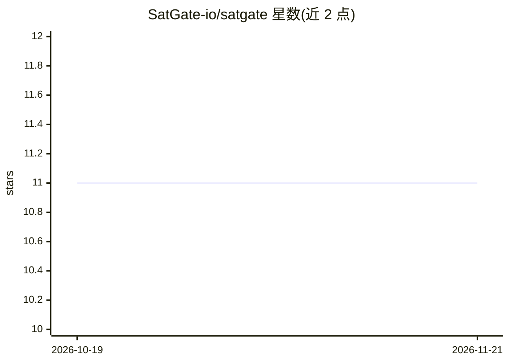

# SatGate-io/satgate

⭐ 11 · Go · Apache-2.0 · 推送 2026-11-20 · [GitHub](https://github.com/SatGate-io/satgate) · [官网](https://satgate.io/) · 组织维护

**给 AI agent 与 MCP 流量做治理的 API 网关：观测、预算管控、付费准入**

以 Go 代理形式部署在 API 与 MCP 工具前：按 MCP JSON-RPC 粒度解析工具调用并归属成本（观测），在请求执行前按 agent/团队/API 强制预算硬停止（管控），通过 L402/Lightning 发票对外部 agent 收费（准入），每次允许或拒绝附签名回执。凭证采用可委托的 Macaroon 能力令牌，支持子令牌缩减预算的委派链。提供 Python/JS SDK、单二进制、Docker、Kubernetes 部署及托管云版本；issue/pay/verify API 命名空间处于私有测试阶段。

## 筛选速览

| 维度 | 判定 | 备注 |
|---|---|---|
| AI 角色 | `ai-ecosystem` | LLM/agent 周边工具 |
| 许可风险 | `permissive` | Apache-2.0 |
| 部署形态 | `desktop` | 安装包/桌面程序 |
| 模型依赖 | — | README 未给出锁定关系 |
| 硬件要求 | — | 无带数字的原话,不猜 |
| 安装摩擦 | `low` | 无编译、无系统依赖或容器化 |
| 成熟度 | `idea` | |

## 能力要点

- MCP JSON-RPC 解析实现按工具粒度的成本归属
- Macaroon 能力令牌支持子代理委托与下一请求撤销
- 预算耗尽即阻断（402），L402/Lightning 付费路由
- 自托管单二进制/Docker/Kubernetes，云托管版另提供控制面

## 适用场景

- 为公司的 agent API 调用设置团队与个体预算硬上限
- 将自有 MCP 工具对外按次收费给第三方 agent
- 审计 agent 花费并留存带签名的允许/拒绝回执

## 场景标签

`模型网关` · 领域:Agent 开发

## 证据(README 行号)

> L21: SatGate is a gateway in front of APIs and MCP tools. It meters agent and MCP traffic (**Observe**), enforces owner 
> L91: SatGate is an **Economic Firewall** for AI agent requests. Drop it in front of your APIs and MCP tools to enforce s
> L109: - 📦 **Self-Hosted** — Your infrastructure, your rules. Single binary, Docker, or Kubernetes.

## 星数曲线

2026-10-19 11 → 2026-11-21 11（+0）

---
*卡片 v1 · prompt 1.4 · 生成 2026-11-18 · 置信度 high · 依据 README sha `caa547e3df11` · [字段定义](../../DATASET.md)*
