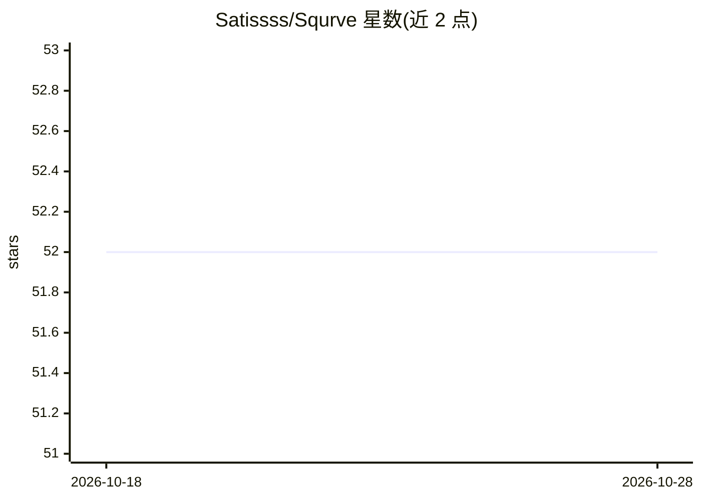

# Satissss/Squrve

⭐ 52 · Python · MIT · 推送 2026-02-23 · [GitHub](https://github.com/Satissss/Squrve) · 组织维护

**面向 Text-to-SQL 研究的模块化框架：复现基线并统一评测**

Python 编写的研究框架，面向 Text-to-SQL 方向的学生与研究者：将现有方法抽象为七类原子 Actor 组件（Reduce/Parse/Generate/Decompose/Scale/Optimize/Select），支持一键复现多个基线方法，并在统一指标下做端到端 Execution Accuracy 评测与组件级评测（如 schema linking 的 Recall/Precision/F1）。内置 Spider、BIRD、Spider2、AmbiDB 四个基准数据集，LLM 仅通过 API 调用接入（Qwen/DeepSeek/OpenAI 等），支持 SQLite、BigQuery、Snowflake 三种数据库。要求 Python 3.11+，通过 git clone 源码运行。

## 筛选速览

| 维度 | 判定 | 备注 |
|---|---|---|
| AI 角色 | `ai-ecosystem` | LLM/agent 周边工具 |
| 许可风险 | `permissive` | MIT |
| 部署形态 | `desktop` | 安装包/桌面程序 |
| 模型依赖 | locked-api |  |
| 硬件要求 | — | 无带数字的原话,不猜 |
| 安装摩擦 | `low` | 无编译、无系统依赖或容器化 |
| 成熟度 | — | 结构信号不足 |

## 能力要点

- 七类原子 Actor 组件与多 Actor 协作机制
- 一键复现多个 Text-to-SQL 基线方法并统一评测（EX 指标）
- 内置 Spider/BIRD/Spider2/AmbiDB 基准数据集支持
- 支持 SQLite/BigQuery/Snowflake 三种数据库

## 适用场景

- 复现和对比已有 Text-to-SQL 方法在统一指标下的表现
- 开发新的 Text-to-SQL 方法并复用 Actor 组件
- 在多个标准基准数据集上评测自己的方法

## 场景标签

`数据分析` `模型评测` · 领域:效率与自动化

## 证据(README 行号)

> L11: **Squrve** is a lightweight and modular framework designed to help beginners in Text-to-SQL research quickly get
> L12: started. It enables one-click reproduction of multiple baseline methods and provides a unified evaluation pipeline,
> L24: Squrve delivers comprehensive benchmarking. It evaluates end-to-end performance using the unified Execution Accurac

## 星数曲线

2026-10-18 52 → 2026-10-28 52（+0）

---
*卡片 v1 · prompt 1.4 · 生成 2026-10-24 · 置信度 high · 依据 README sha `d77f90764a7a` · [字段定义](../../DATASET.md)*
