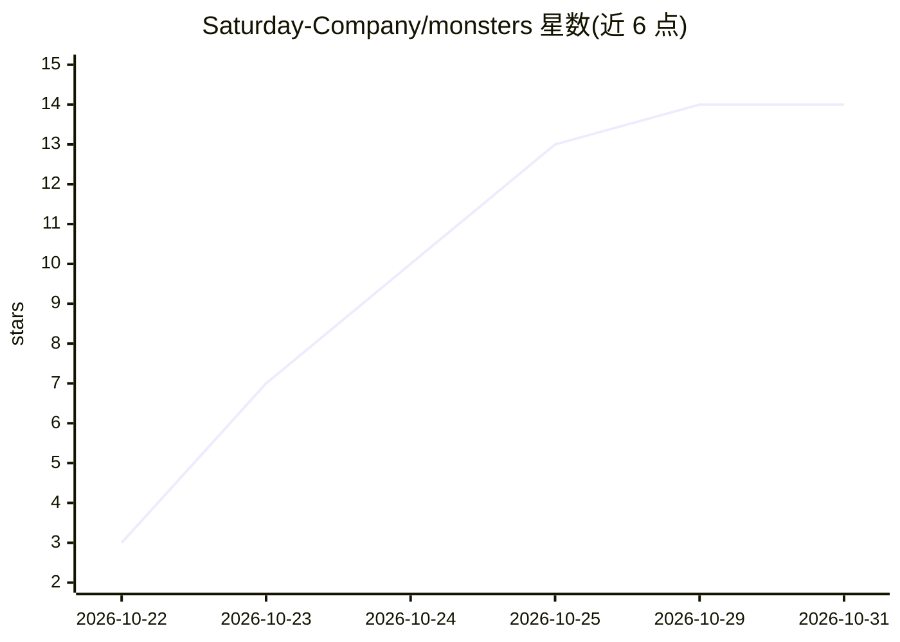

# Saturday-Company/monsters

⭐ 14 · TypeScript · Apache-2.0 · 推送 2026-10-28 · [GitHub](https://github.com/Saturday-Company/monsters) · [官网](https://getmonsters.dev) · 组织维护 · 中文 README

**本地多智能体桌面应用：一队 AI agent 在自己电脑上干活**

面向终端用户的 local-first 桌面应用：一个 lead agent 规划并委派任务给多个 monster agent 并行执行，仅在需要用户决策时给出 2-4 个选项提问，完成后交付可撤销的回执。每个 monster 有独立聊天、权限与主备模型；模型自带，支持 OpenRouter 免费模型、Anthropic/OpenAI/Google/Mistral/Groq API key、Claude/ChatGPT 订阅或 Ollama/LM Studio 本地模型。知识存于 Obsidian 兼容 Markdown 文件夹，每次修改为 git commit；提供 Telegram/SSH 远程访问、支出上限与一键 Stop。跨平台提供 AppImage/.deb/.dmg/.exe 安装包。自述为 0.1.0-alpha 阶段。

## 筛选速览

| 维度 | 判定 | 备注 |
|---|---|---|
| AI 角色 | `ai-native` | 本体是模型或模型工具 |
| 许可风险 | `permissive` | Apache-2.0 |
| 部署形态 | `desktop` | 安装包/桌面程序 |
| 模型依赖 | local-ok | 支持本地模型 |
| 硬件要求 | — | 无带数字的原话,不猜 |
| 安装摩擦 | `low` | 无编译、无系统依赖或容器化 |
| 成熟度 | `idea` | |

## 能力要点

- lead 规划、委派、验收的多 agent 协作（回执可整单撤销）
- Obsidian 兼容笔记库，agent 每次编辑均为 git commit
- Telegram / SSH 终端远程控制与一键 Stop 停止全部工作
- 应用接入 GitHub/Notion/Linear/Slack 及任意 MCP 应用

## 适用场景

- 让一组 AI agent 在自己电脑上完成项目与定时自动化任务
- 通过 Telegram 从手机指挥和查看 agent 工作
- 把 agent 笔记库通过 monsters mcp 暴露给 Claude Desktop/Codex/Cursor

## 场景标签

`多智能体` `AI 助手` `工作流自动化` · 领域:Agent 开发

## 证据(README 行号)

> L5: **A local-first, provider-agnostic agentic hub: a squad of small AI agents ("monsters") that work on your own comput
> L10: in Activity, and one **Stop** key halts all work at once. It is a desktop app for Linux, Windows and macOS, and you
> L11: bring your own models: free ones through OpenRouter, the Claude or ChatGPT plan you already pay for, API keys, or

## 星数曲线

2026-10-22 3 → 2026-10-31 14（+11）

---
*卡片 v1 · prompt 1.4 · 生成 2026-10-31 · 置信度 mid · 依据 README sha `907827fc6aa4` · [字段定义](../../DATASET.md)*
