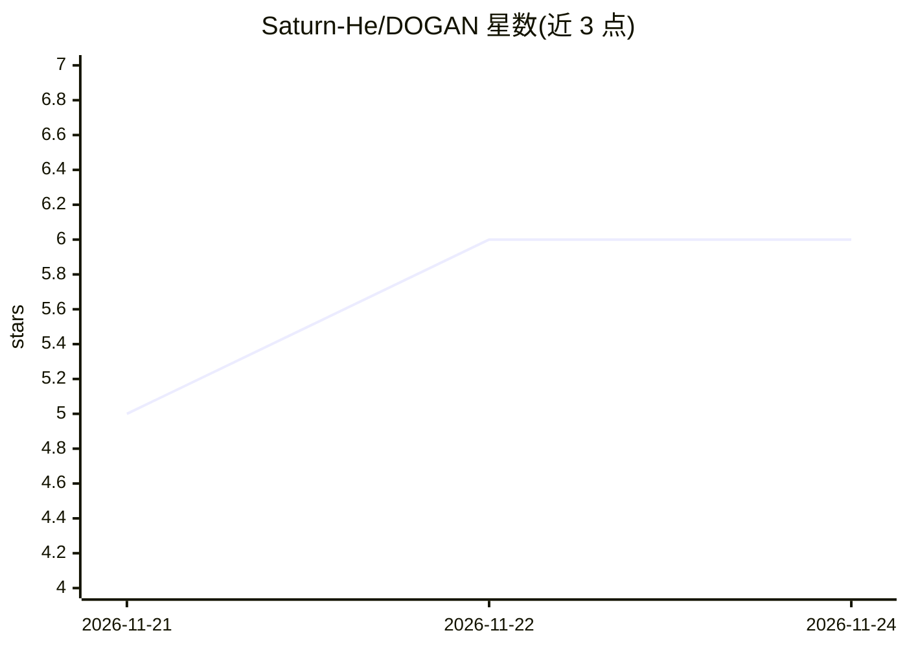

# Saturn-He/DOGAN

⭐ 6 · Python · 推送 2026-11-22 · [GitHub](https://github.com/Saturn-He/DOGAN) · [官网](https://doi.org/10.1109/TGRS.2025.3606979) · 组织维护

**研究者可复现论文的 SAR 到光学图像翻译 PyTorch 实现**

IEEE TGRS 2025 论文 DOGAN 的官方 PyTorch 实现：训练时用冻结的 DINO ViT-S/16 骨干加轻量适配器提取多尺度光学先验，通过 L1 与 MK-MMD 损失做多尺度域对齐来引导生成器；推理时仅用训练好的生成器将 SAR 图像翻译为类光学图像。仓库提供训练、推理与六项图像质量指标（PSNR/SSIM/CW-SSIM/RMSE/LPIPS/SAM）评测脚本，需用户自备成对 SAR/光学数据集。

## 筛选速览

| 维度 | 判定 | 备注 |
|---|---|---|
| AI 角色 | `ai-native` | 本体是模型或模型工具 |
| 许可风险 | `none` | — |
| 部署形态 | `library` | 以包/库形式分发 |
| 模型依赖 | — | README 未给出锁定关系 |
| 硬件要求 | — | 无带数字的原话,不猜 |
| 安装摩擦 | `medium` | 含编译或系统依赖之一 |
| 成熟度 | — | 结构信号不足 |

## 能力要点

- DINO 骨干冻结 + SOA 适配器提取多尺度光学先验
- 提供训练、推理、评测完整脚本与 256/512 两种裁剪配置
- 六个论文图像质量指标的独立评测脚本
- 支持训练自动下载 ResNet-50 权重

## 适用场景

- 复现论文的 SAR 到光学图像翻译实验
- 在自己的成对 SAR/光学数据上训练与推理
- 用 PSNR/SSIM/LPIPS 等指标评估翻译结果

## 场景标签

 · 领域:遥感/计算机视觉

## 证据(README 行号)

> L19: **DOGAN transfers optical priors from a pretrained DINO model into a SAR-to-optical translation GAN.** During train
> L47: This repository provides training, inference, and image-quality evaluation code.
> L51: Use Python 3.10. Install PyTorch 2.1 and torchvision 0.16 for your CUDA version, then run:

## 星数曲线

2026-11-21 5 → 2026-11-24 6（+1）

---
*卡片 v1 · prompt 1.4 · 生成 2026-11-21 · 置信度 high · 依据 README sha `9b1171ce61f4` · [字段定义](../../DATASET.md)*
