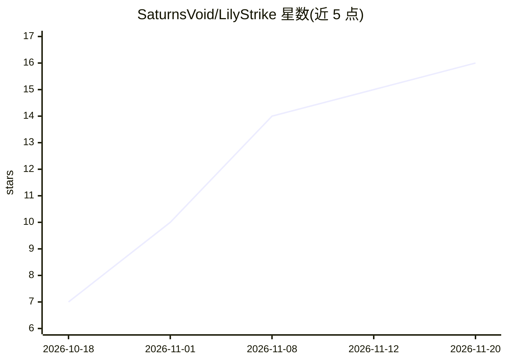

# SaturnsVoid/LilyStrike

⭐ 16 · C++ · NOASSERTION · 推送 2026-09-06 · [GitHub](https://github.com/SaturnsVoid/LilyStrike) · [官网](https://saturnsvoid.github.io/LilyStrike/flasher/) · 个人维护

**LILYGO T-Dongle-S3 渗透测试与 BadUSB 固件工具包**

面向 LILYGO T-Dongle-S3（ESP32-S3）的 offensive-security 固件：DuckyScript 解释器执行 HID 键鼠 payload、WiFi 侦测与 deauth 攻击、EvilAP + Karma 假热点、主机 ARP/TCP 扫描、AES-256-GCM 加密 SD 卡存储、WebSocket 实时 Web UI。可选启用 MCP 服务器（12 个工具），让 Claude 等 MCP 客户端枚举脚本、执行 payload、读取设备状态。安装提供浏览器 Web Flasher 或 PlatformIO 源码构建，首启需接受 EULA。

## 筛选速览

| 维度 | 判定 | 备注 |
|---|---|---|
| AI 角色 | `ai-enhanced` | 去掉 AI 部分产品仍成立 |
| 许可风险 | `none` | NOASSERTION |
| 部署形态 | `library` | 以包/库形式分发 |
| 模型依赖 | — | README 未给出锁定关系 |
| 硬件要求 | — | 无带数字的原话,不猜 |
| 安装摩擦 | `low` | 无编译、无系统依赖或容器化 |
| 成熟度 | — | 结构信号不足 |

## 能力要点

- DuckyScript 解释器，支持变量、条件、主机 OS 指纹、约 50 条设备命令
- EvilAP + Karma 假热点与 5 种 deauth 攻击变体
- MCP 服务器 12 个工具，供 Claude 等 AI 客户端驱动设备
- 脚本/日志/设置/抓包 AES-256-GCM 静态加密

## 适用场景

- 在授权目标机上执行 HID 键盘注入 payload
- WiFi 侦测、deauth 测试与假热点凭据收集实验
- 通过 AI 助手（MCP 客户端）远程操作设备执行脚本

## 场景标签

`网络安全` · 领域:学习与行业

## 证据(README 行号)

> L7: LilyStrike turns a $10-looking USB dongle into a complete offensive-security toolkit: HID payload execution, WiFi re
> L40: - **MCP server** — 12 tools so Claude/any MCP client can enumerate scripts, run payloads, and read device state (se
> L98: Settings → **MCP enabled**, set a token (Settings → MCP), and point any MCP client at `POST http://<device-ip>/mcp`

## 星数曲线

2026-10-18 7 → 2026-11-20 16（+9）

---
*卡片 v1 · prompt 1.4 · 生成 2026-11-18 · 置信度 mid · 依据 README sha `f957960e8ef6` · [字段定义](../../DATASET.md)*
