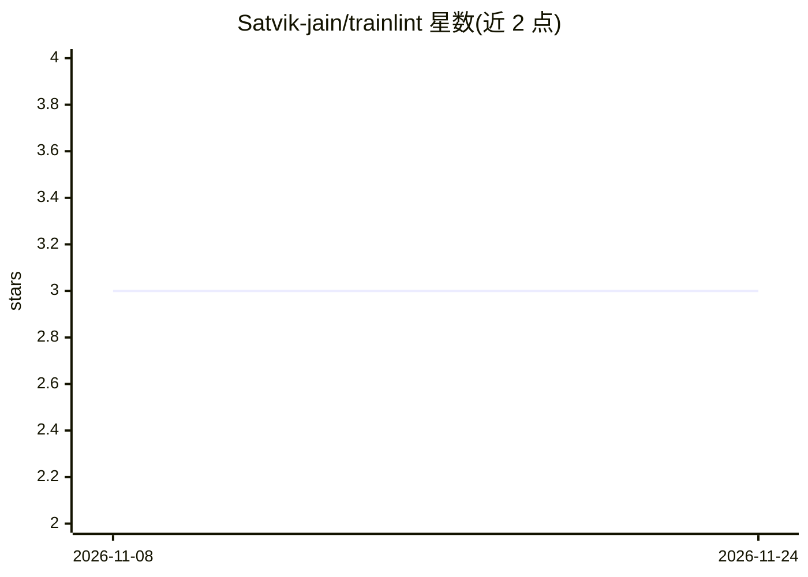

# Satvik-jain/trainlint

⭐ 3 · Python · MIT · 推送 2026-11-03 · [GitHub](https://github.com/Satvik-jain/trainlint) · 个人维护

**给 ML 开发者的静态检查器：捕获不报错的训练代码缺陷**

一个离线 Python 静态检查器与配套 agent skills，针对不会崩溃的 ML bug：数据泄漏、train/eval 模式、损失与指标误用等，共 14 条规则（TL001–TL014）。基于标准库 ast 解析代码、从不执行代码、无依赖、不联网。检查结果给出行号、代码定位与一行修复建议，支持 JSON 输出、规则筛选、行级 ignore 注释与 GitHub Actions 集成。附带四个 agent skills 安装到 coding agent 的 skills 目录，帮助 agent 在写代码时规避同类问题。

## 筛选速览

| 维度 | 判定 | 备注 |
|---|---|---|
| AI 角色 | `ai-ecosystem` | LLM/agent 周边工具 |
| 许可风险 | `permissive` | MIT |
| 部署形态 | `library` | 以包/库形式分发 |
| 模型依赖 | — | README 未给出锁定关系 |
| 硬件要求 | — | 无带数字的原话,不猜 |
| 安装摩擦 | `low` | 无编译、无系统依赖或容器化 |
| 成熟度 | — | 结构信号不足 |

## 能力要点

- 14 条针对 ML 训练/评估代码的静态检查规则，附一行修复建议
- 纯标准库实现，解析不执行，零依赖且不联网
- 附带 4 个 agent skills（数据泄漏/训练循环/指标评估/断点恢复）可装入 coding agent
- 输出文本或 JSON，支持 CI 中以退出码判定

## 适用场景

- 在提交或 CI 中检查训练脚本是否存在数据泄漏等静默 bug
- 让 coding agent 安装 skills 后避免写出 eval 模式、指标误用等问题
- 审查他人 ML 代码时快速定位可疑行

## 场景标签

 · 领域:开发者工具/ML 代码质量

## 证据(README 行号)

> L3: Agent skills and an offline checker for ML bugs that do not crash.
> L59: small offline checker for the common cases, plus skills that tell an agent how to avoid them in
> L64: - Fourteen rules, TL001 to TL014, listed below and explained with examples in

## 星数曲线

2026-11-08 3 → 2026-11-24 3（+0）

---
*卡片 v1 · prompt 1.4 · 生成 2026-11-22 · 置信度 high · 依据 README sha `6e9f04fa7797` · [字段定义](../../DATASET.md)*
