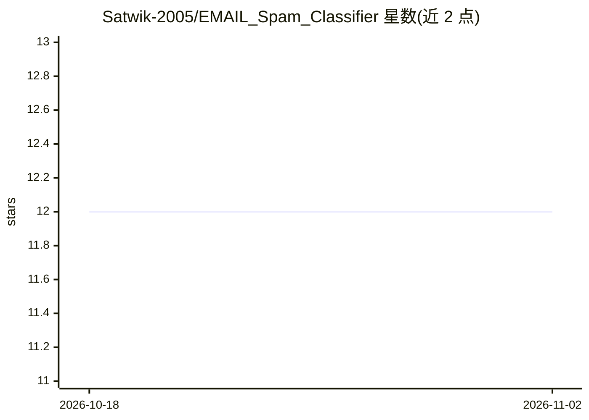

# Satwik-2005/EMAIL_Spam_Classifier

⭐ 12 · Jupyter Notebook · MIT · 推送 2026-01-27 · [GitHub](https://github.com/Satwik-2005/EMAIL_Spam_Classifier) · 个人维护

**基于 TF-IDF 与机器学习的垃圾邮件分类 Web 应用**

机器学习垃圾邮件分类项目：在 Jupyter notebook 中训练与测试模型，使用 NLP 与 TF-IDF 特征，通过 Streamlit 式 app.py 提供交互式网页界面判定邮件为垃圾或正常。运行方式为将 app.py、model.pkl、vectorizer.pkl 三个文件加入 PyCharm 新项目并在终端运行 app.py。README 提供界面截图，未给出依赖安装命令与数据集说明。

## 筛选速览

| 维度 | 判定 | 备注 |
|---|---|---|
| AI 角色 | `ai-native` | 本体是模型或模型工具 |
| 许可风险 | `permissive` | MIT |
| 部署形态 | `None` |  |
| 模型依赖 | — | README 未给出锁定关系 |
| 硬件要求 | — | 无带数字的原话,不猜 |
| 安装摩擦 | `low` | 无编译、无系统依赖或容器化 |
| 成熟度 | — | 结构信号不足 |

## 能力要点

- NLP + TF-IDF 特征的垃圾/正常邮件二分类
- 模型训练与测试在 Jupyter notebook 中完成
- 交互式 Web 界面运行预测

## 适用场景

- 通过网页界面判断邮件是否为垃圾邮件
- 学习 TF-IDF 文本特征与分类模型的部署流程

## 场景标签

 · 领域:NLP/机器学习

## 证据(README 行号)

> L2: I have created, trained and tested the Machine Learning Model in Jupyter notebook and then I have executed the proje
> L4: To test the project , add the given 3 files : app.py, model.pkl, vectorizer.pkl to PyCharm new project and then run 

## 星数曲线

2026-10-18 12 → 2026-11-02 12（+0）

---
*卡片 v1 · prompt 1.4 · 生成 2026-11-01 · 置信度 low · 依据 README sha `58f18868e783` · [字段定义](../../DATASET.md)*
