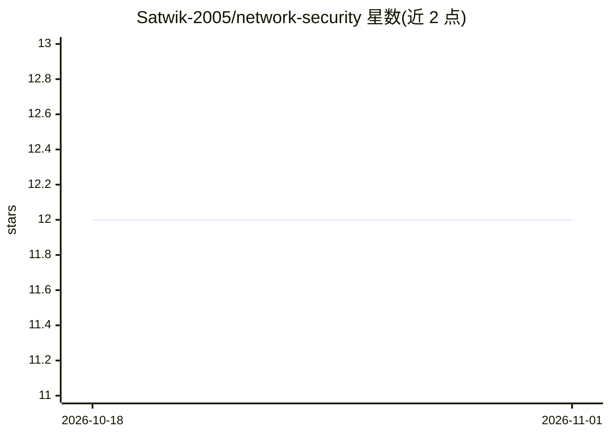

# Satwik-2005/network-security

⭐ 12 · Python · 推送 2026-06-29 · [GitHub](https://github.com/Satwik-2005/network-security) · 个人维护

**基于 ML 的钓鱼网站检测系统，含完整 MLOps 流程**

端到端机器学习与 MLOps 项目：从 MongoDB Atlas 读取钓鱼网站数据集，经模式校验与漂移检测（Evidently AI）、预处理后训练 Random Forest、Decision Tree、Gradient Boosting、Logistic Regression、AdaBoost 五种分类器，按评估指标自动选优，用 MLflow 记录 F1/Precision/Recall 与产物，最终通过 FastAPI 提供 /train 训练与 /predict CSV 批量预测端点。模型基于 30 个 URL 与网站特征判定网站是否为钓鱼。Docker 支持标注为可选。

## 筛选速览

| 维度 | 判定 | 备注 |
|---|---|---|
| AI 角色 | `ai-native` | 本体是模型或模型工具 |
| 许可风险 | `none` | — |
| 部署形态 | `library` | 以包/库形式分发 |
| 模型依赖 | — | README 未给出锁定关系 |
| 硬件要求 | — | 无带数字的原话,不猜 |
| 安装摩擦 | `low` | 无编译、无系统依赖或容器化 |
| 成熟度 | — | 结构信号不足 |

## 能力要点

- 训练 5 种分类器并按评估指标自动选优
- MLflow 记录 F1/Precision/Recall 与实验历史
- FastAPI 提供 /train 与 /predict（CSV 批量预测）端点
- 数据漂移检测（Evidently AI）与 MongoDB Atlas 数据摄取

## 适用场景

- 我想通过上传 CSV 批量判定网站是否为钓鱼站点
- 我想跑一个包含数据校验、训练、实验跟踪的 ML 流程示例
- 我想以 REST API 形式提供钓鱼网站检测服务

## 场景标签

`MLOps` `网络安全` · 领域:学习与行业

## 证据(README 行号)

> L5: An end-to-end Machine Learning and MLOps project that detects whether a website is **Legitimate** or **Phishing** us
> L144: Upload a CSV file containing website features to receive predictions.

## 星数曲线

2026-10-18 12 → 2026-11-01 12（+0）

---
*卡片 v1 · prompt 1.4 · 生成 2026-11-01 · 置信度 high · 依据 README sha `1fc2136eb38a` · [字段定义](../../DATASET.md)*
