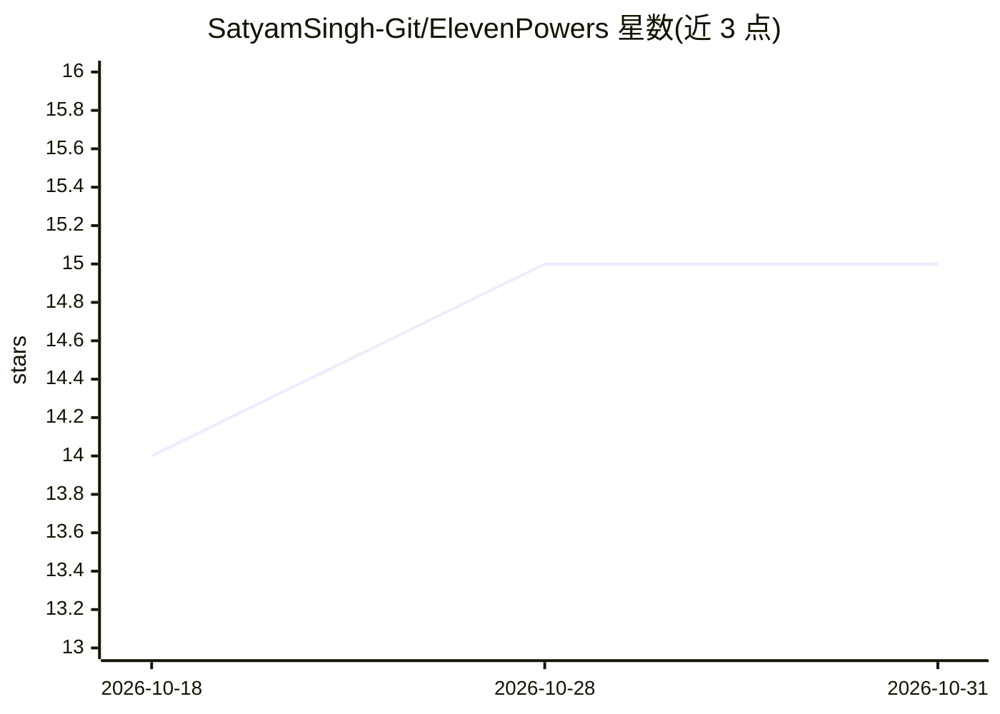

# SatyamSingh-Git/ElevenPowers

⭐ 15 · Python · 推送 2026-10-30 · [GitHub](https://github.com/SatyamSingh-Git/ElevenPowers) · [官网](https://satyamsingh-git.github.io/ElevenPowers/architecture/) · 个人维护

**为编码 agent 提供“完成”判定的证据验证层**

面向使用编码 agent 的开发者：读取 agent 已运行命令（测试、类型检查、构建）的输出并将其归档为证据，每条记录绑定所观察文件的内容指纹；编辑文件后对应证据标记为 STALE，类似 make 对目标文件的失效机制。计算 VERIFIED/UNVERIFIED/STALE/CONTRADICTED 四种验证状态，按变更风险提出验证义务，可导出 Markdown/JSON 证据报告，支持 Claude Code、Codex、Gemini CLI、Cursor Agent、GitHub Copilot CLI 五种宿主集成。README 含对 14 个 agent 系统的源码调研。

## 筛选速览

| 维度 | 判定 | 备注 |
|---|---|---|
| AI 角色 | `ai-ecosystem` | LLM/agent 周边工具 |
| 许可风险 | `none` | — |
| 部署形态 | `None` |  |
| 模型依赖 | — | README 未给出锁定关系 |
| 硬件要求 | — | 无带数字的原话,不猜 |
| 安装摩擦 | `low` | 无编译、无系统依赖或容器化 |
| 成熟度 | — | 结构信号不足 |

## 能力要点

- 读取 agent 已运行命令的输出并绑定文件指纹形成证据记录
- 证据随代码编辑失效（STALE），四状态验证模型
- 按变更风险（auth/payments/迁移等）提出验证义务
- 五种宿主集成：Claude Code、Codex、Gemini CLI、Cursor Agent、GitHub Copilot CLI

## 适用场景

- 核验编码 agent 声称任务完成时是否有新鲜证据支撑
- 追踪文件变更使旧测试证据失效并提示重跑
- 导出证据报告说明哪些检查已做、哪些缺失

## 场景标签

`代码审查` · 领域:编码与开发

## 证据(README 行号)

> L16: > **What this is.** An evidence and verification layer for coding agents, with change-impact analysis and project h
> L30: 8. **Five host integrations:** Claude Code, Codex, Gemini CLI, Cursor Agent and GitHub Copilot CLI.

## 星数曲线

2026-10-18 14 → 2026-10-31 15（+1）

---
*卡片 v1 · prompt 1.4 · 生成 2026-10-31 · 置信度 high · 依据 README sha `ceef9179b92a` · [字段定义](../../DATASET.md)*
