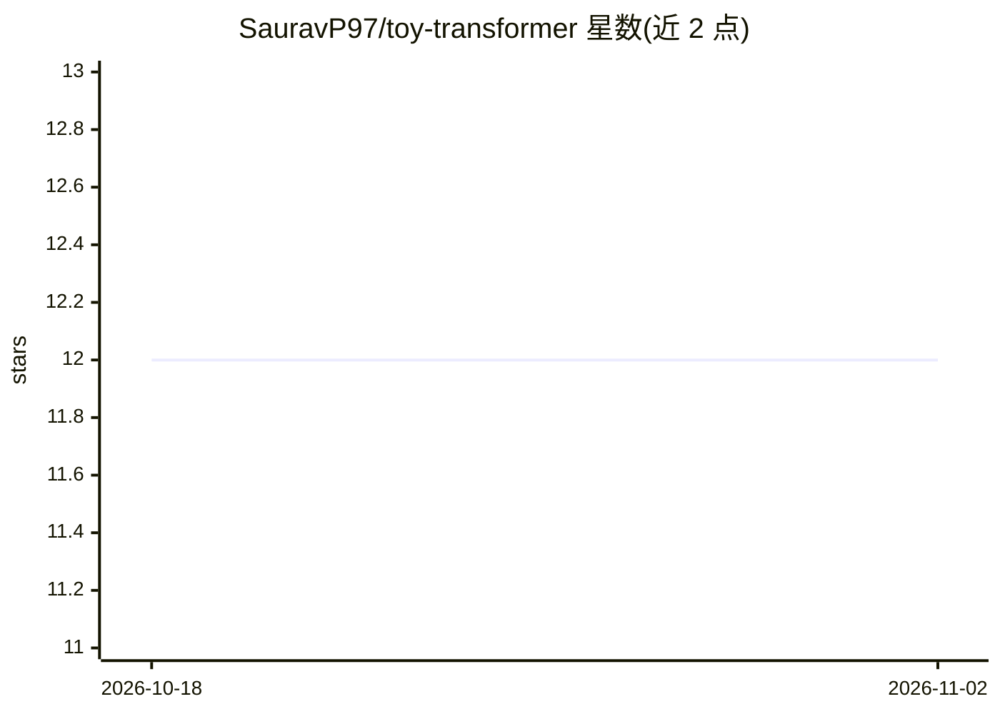

# SauravP97/toy-transformer

⭐ 12 · Python · MIT · 推送 2026-03-31 · [GitHub](https://github.com/SauravP97/toy-transformer) · [官网](https://huggingface.co/SauravP97/toy-transformer-shakespeare-work) · 个人维护

**从零实现的 decoder-only Transformer 教学与训练库（0.21M 参数）**

用 PyTorch 从零实现仅解码器、带掩码注意力的 Transformer（0.21M 参数，4 头 4 层），提供字符级 Tokenizer、Trainer 训练与推理生成三类模块，可在本地 CPU 上对任意文本块训练并生成文本，GPU 可选。训练流程分三步：分词、训练迭代（可调 batch_size/block_size 等）、生成与解码；2026 年 3 月加入 KV-Cache 推理优化，作者报告 Shakespeare 数据集上 2000 token 生成时间减少 20.12%。灵感来自 karpathy 的 nanogpt 实现。

## 筛选速览

| 维度 | 判定 | 备注 |
|---|---|---|
| AI 角色 | `ai-native` | 本体是模型或模型工具 |
| 许可风险 | `permissive` | MIT |
| 部署形态 | `None` |  |
| 模型依赖 | — | README 未给出锁定关系 |
| 硬件要求 | — | 无带数字的原话,不猜 |
| 安装摩擦 | `low` | 无编译、无系统依赖或容器化 |
| 成熟度 | — | 结构信号不足 |

## 能力要点

- decoder-only + 掩码注意力实现，参数量 0.21M（4 头、嵌入维度 64、4 层）
- 字符级 Tokenizer、Trainer、推理生成三模块端到端可用，CPU 即可训练
- KV-Cache 推理优化，生成 2000 token 耗时减少 20.12%（作者自测数据）
- 内置训练/验证集划分与损失曲线输出

## 适用场景

- 在本地无 GPU 环境下训练小型语言模型并生成文本
- 学习 Transformer 掩码注意力与 KV-Cache 的实现细节
- 以 Shakespeare 文本为示例快速跑通训练与推理流程

## 场景标签

`教程课程` `模型训练` · 领域:学习与行业

## 证据(README 行号)

> L3: A toy Transformer) model (0.21M parameters)implementation from scratch! If you have a block of text on which you wan
> L15: The Transformer implemented in this repo is a Decoder-only transformer which uses masked attention. Meaning the tok

## 星数曲线

2026-10-18 12 → 2026-11-02 12（+0）

---
*卡片 v1 · prompt 1.4 · 生成 2026-11-01 · 置信度 high · 依据 README sha `9adc8d7fe4d1` · [字段定义](../../DATASET.md)*
