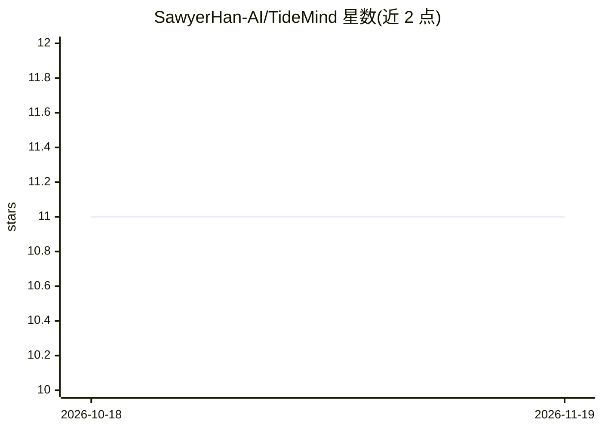

# SawyerHan-AI/TideMind

⭐ 11 · TypeScript · MIT · 推送 2026-11-18 · [GitHub](https://github.com/SawyerHan-AI/TideMind) · [官网](https://tidemind.ai/) · 个人维护 · 中文 README

**跨 AI 工具与笔记的本地优先记忆层/知识图谱**

TideMind 是一个运行在本机的记忆层：将多个 AI 工具的对话、Obsidian/Logseq/Apple Notes 等笔记整合为单一 SQLite 知识图谱，通过 MCP 协议向 AI 工具暴露 brain_prepare/brain_recall/brain_digest 三个工具，在对话开始时提供用户画像与记忆上下文，检索时沿记忆链接按需扩展。无 LLM provider 时退化为 BM25 关键词检索并跳过高级功能。数据本地存储，可导出 Markdown，提供桌面客户端用于浏览图谱与监控后台代谢任务。

## 筛选速览

| 维度 | 判定 | 备注 |
|---|---|---|
| AI 角色 | `ai-ecosystem` | LLM/agent 周边工具 |
| 许可风险 | `permissive` | MIT |
| 部署形态 | `library` | 以包/库形式分发 |
| 模型依赖 | local-ok | 支持本地模型 |
| 硬件要求 | — | 无带数字的原话,不猜 |
| 安装摩擦 | `low` | 无编译、无系统依赖或容器化 |
| 成熟度 | — | 结构信号不足 |

## 能力要点

- 通过 MCP 协议向 AI 工具暴露三个认知工具（prepare/recall/digest）
- 记忆图节点含四个成熟度维度，后台每日/每周执行衰减与发散扫描
- 本地 SQLite 存储，支持导出 Markdown，可用 Ollama 全本地运行
- 接入 Obsidian、Logseq、Apple Notes 笔记同步

## 适用场景

- 让多个 AI 工具共享同一份用户记忆与画像
- 将笔记与 AI 对话内容织入统一知识图谱
- 离线全本地运行以避免数据外发

## 场景标签

`知识图谱` `Agent 记忆` · 领域:Agent 开发

## 证据(README 行号)

> L22: TideMind is a memory layer that spans all your tools — a living knowledge graph that connects your AI, your notes, 
> L36: **Simple to start.** Connect your AI tools through the MCP protocol — one config, no habit changes. Import and sync
> L107: TideMind exposes three tools via the MCP protocol, corresponding to three cognitive operations:

## 星数曲线

2026-10-18 11 → 2026-11-19 11（+0）

---
*卡片 v1 · prompt 1.4 · 生成 2026-11-18 · 置信度 high · 依据 README sha `4154753bff9e` · [字段定义](../../DATASET.md)*
