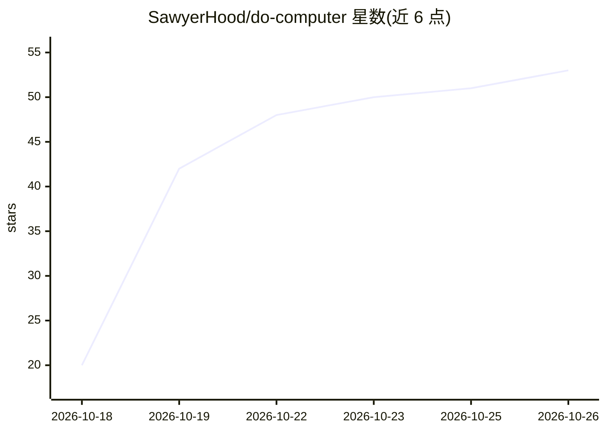

# SawyerHood/do-computer

⭐ 53 · TypeScript · MIT · 推送 2026-10-25 · [GitHub](https://github.com/SawyerHood/do-computer) · [官网](https://do.computer) · 个人维护

**可自托管的常驻个人 AI agent，每个 agent 拥有自己的电脑**

开源的自托管个人 agent 平台：每个 agent（称 Dood）有名字、形象、记忆和可操作的计算机（内置 shell、Daytona/Modal/Cloudflare 容器或用户自己的机器）。支持定时任务、技能学习、MCP 连接器接入外部服务、浏览器操控与团队共享。模型经 OpenRouter 或用户自有 key 调用；无 key 时运行内置 echo 模型。同一代码库可运行于 Node 或 Cloudflare Workers，另有 macOS/Windows/Linux 桌面端与 Expo 移动端（需自行构建）。README 声明项目处于早期阶段。

## 筛选速览

| 维度 | 判定 | 备注 |
|---|---|---|
| AI 角色 | `ai-native` | 本体是模型或模型工具 |
| 许可风险 | `permissive` | MIT |
| 部署形态 | `library` | 以包/库形式分发 |
| 模型依赖 | locked-api |  |
| 硬件要求 | — | 无带数字的原话,不猜 |
| 安装摩擦 | `low` | 无编译、无系统依赖或容器化 |
| 成熟度 | `idea` | |

## 能力要点

- agent 关闭标签页后继续工作，支持子 agent 并行
- 可在多种机器上执行命令与编辑文件，包括用户自己的电脑
- 远程 MCP 服务器可作为 connector 接入，支持 Gmail/Notion/GitHub 等应用一键登录
- 同一代码库运行于 Node 与 Cloudflare Workers，数据分别为 SQLite 文件或 D1/DO/R2

## 适用场景

- 自托管一个常驻的、能定时执行任务的个人 AI 助手
- 让 agent 在我自己的电脑上跑命令、改文件、操作浏览器
- 团队共享 agent、对话与文件，或在 Slack 中作为 bot 使用

## 场景标签

`AI 助手` `浏览器自动化` · 领域:效率与自动化

## 证据(README 行号)

> L11: Do Computer gives you agents, called Doods, that each have a name, a face, a memory and computers
> L16: One codebase runs on plain Node and on Cloudflare Workers. Models are called through
> L17: OpenRouter or a provider you sign in to, and the agent loop is

## 星数曲线

2026-10-18 20 → 2026-10-26 53（+33）

---
*卡片 v1 · prompt 1.4 · 生成 2026-10-24 · 置信度 mid · 依据 README sha `db4555c2f997` · [字段定义](../../DATASET.md)*
