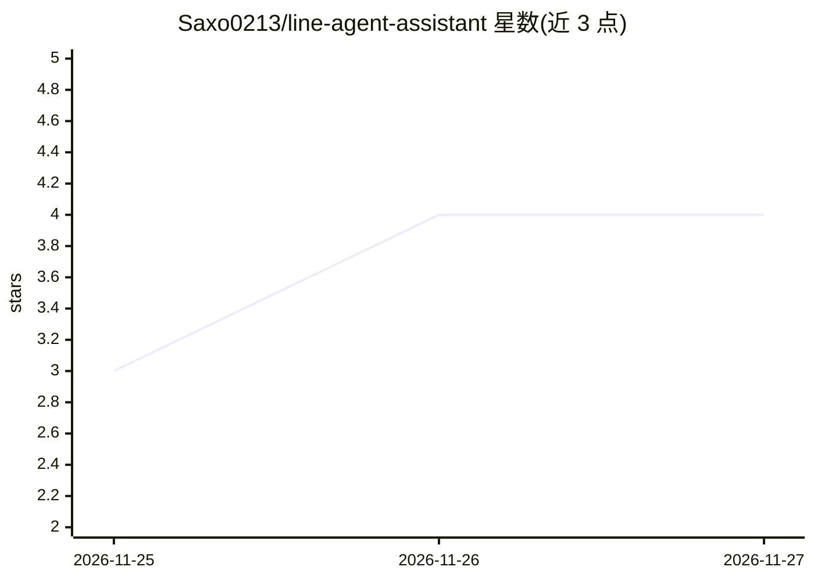

# Saxo0213/line-agent-assistant

⭐ 4 · TypeScript · MIT · 推送 2026-11-23 · [GitHub](https://github.com/Saxo0213/line-agent-assistant) · 个人维护 · 中文 README

**让 Claude/Codex 通过 LINE 接收指令并回复的 Windows 桌面助手**

基于 Electron 的非官方 Windows 桌面应用，通过双 LINE 账号分工工作：Agent 账号在应用内扫码登录，接收管理员发来的 LINE 指令并转交本机安装的 Claude 或 Codex CLI 执行，回传结果与定时/代发消息；管理员账号以监控模式读取桌面 LINE 的本地消息记录，供应用内查看与搜索。提供本地 MCP bridge（仅监听 127.0.0.1）让 Claude Desktop/Codex 读取会话和发送消息。依赖非官方 LINE 协议，存在失效风险；MCP 端点无鉴权。提供安装包与源码构建两种方式。

## 筛选速览

| 维度 | 判定 | 备注 |
|---|---|---|
| AI 角色 | `ai-native` | 本体是模型或模型工具 |
| 许可风险 | `permissive` | MIT |
| 部署形态 | `desktop` | 安装包/桌面程序 |
| 模型依赖 | — | README 未给出锁定关系 |
| 硬件要求 | — | 无带数字的原话,不猜 |
| 安装摩擦 | `low` | 无编译、无系统依赖或容器化 |
| 成熟度 | — | 结构信号不足 |

## 能力要点

- Agent 账号经 LINE 接收指令，调用本机 Claude/Codex CLI 执行并回复
- MCP bridge 使 Claude Desktop 与 Codex 可列会话、读相册/笔记、发定时消息
- 管理员账号监控模式：读取桌面 LINE 本地消息记录并可搜索
- 多 CLI 账号来源自动 failover、每会话 /model 命令、附件读取

## 适用场景

- 通过 LINE 消息远程指挥电脑上的 AI agent 执行任务
- 在应用内统一查看和搜索两个 LINE 账号的聊天记录
- 让 Claude Desktop 直接操作 LINE 发送或定时消息

## 场景标签

`AI 助手` · 领域:对话与助手

## 证据(README 行号)

> L7: **Put Claude or Codex to work on your LINE chats.** A Windows desktop app that lets an AI agent take instructions ov
> L13:  Agent account: A dedicated LINE account that logs in inside the app by QR code (Windows version by default, Chrome
> L54: 3. **Prepare the AI (required):** go to **Settings → Assistant**, install and log in to the official Claude or Code

## 星数曲线

2026-11-25 3 → 2026-11-27 4（+1）

---
*卡片 v1 · prompt 1.4 · 生成 2026-11-24 · 置信度 high · 依据 README sha `92535d8346f6` · [字段定义](../../DATASET.md)*
