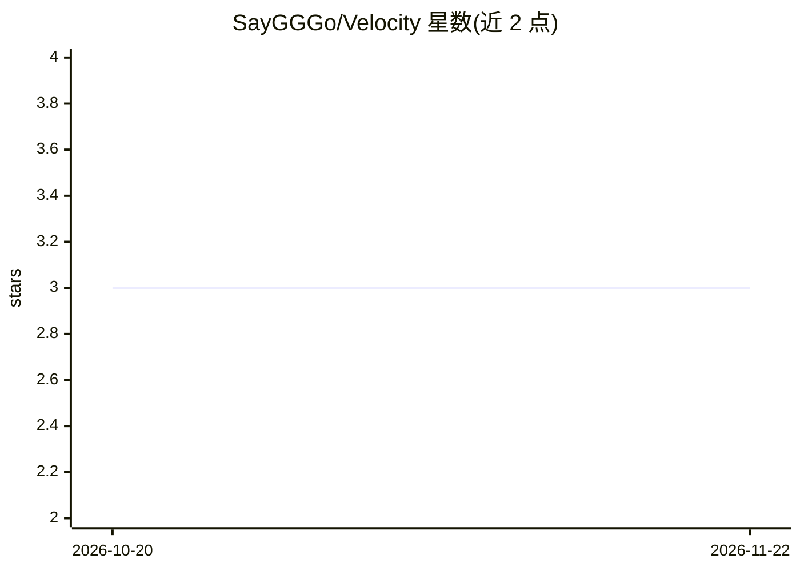

# SayGGGo/Velocity

⭐ 3 · NOASSERTION · 推送 2026-10-11 · [GitHub](https://github.com/SayGGGo/Velocity) · [官网](https://isvelocity.ru) · 组织维护

**面向学生的一站式 AI 教育学习平台**

Velocity 是一个在线教育平台，将学习材料、练习与 AI 工具放在同一账号内，面向中学生、大学生及自学人群，覆盖备考、学期学习与项目提交等场景。界面包含个人仪表盘、账号创建、AI 聊天、余额充值与模型目录五个屏幕。架构为 React 前端加 Flask API，涉及数据、AI 与支付模块，由 GG Protect 提供前端防护。盈利模式为 B2C 模型资费、token 包与余额充值，B2B 为发展方向。README 未提供安装与运行方式，原创材料权利受保留声明限制。

## 筛选速览

| 维度 | 判定 | 备注 |
|---|---|---|
| AI 角色 | `ai-native` | 本体是模型或模型工具 |
| 许可风险 | `none` | NOASSERTION |
| 部署形态 | `None` |  |
| 模型依赖 | — | README 未给出锁定关系 |
| 硬件要求 | — | 无带数字的原话,不猜 |
| 安装摩擦 | `low` | 无编译、无系统依赖或容器化 |
| 成熟度 | — | 结构信号不足 |

## 能力要点

- AI 聊天、模型目录与余额管理整合在同一学习账号
- React 前端 + Flask API 架构，GG Protect 防护前端
- 支持 OAuth 2.0 的 API 与文档（GitBook）
- B2C 计费：模型资费、token 包与余额充值

## 适用场景

- 备考 ЕГЭ/ОГЭ 或学期课程时在一个平台学习和练习
- 按任务选择平台内模型并管理使用余额
- 自学新知识并跟踪个人学习进度

## 场景标签

`聊天机器人` · 领域:对话与助手

## 证据(README 行号)

> L5:  Что такое Velocity? Образовательная платформа с AI-инструментами. Учёба, практика и нейросети — в одном аккаунте. Д
> L20:  Архитектура проекта. Пользователь → интерфейс React → Flask API → данные, AI и платежи. GG Protect обслуживает фро

## 星数曲线

2026-10-20 3 → 2026-11-22 3（+0）

---
*卡片 v1 · prompt 1.4 · 生成 2026-11-22 · 置信度 mid · 依据 README sha `da849ae523f3` · [字段定义](../../DATASET.md)*
