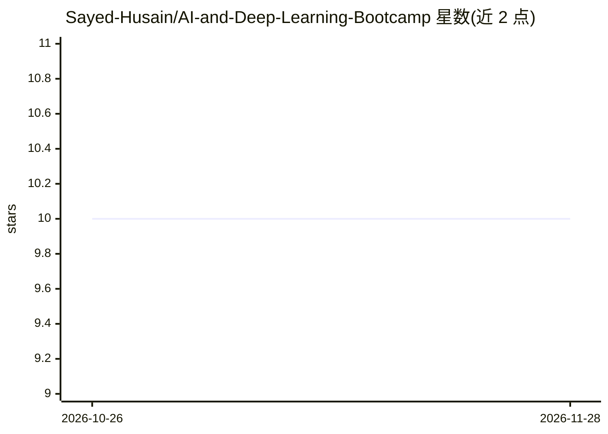

# Sayed-Husain/AI-and-Deep-Learning-Bootcamp

⭐ 10 · Jupyter Notebook · 推送 2025-12-25 · [GitHub](https://github.com/Sayed-Husain/AI-and-Deep-Learning-Bootcamp) · 个人维护

**AI 与深度学习入门训练营：Python+TensorFlow 笔记本课程**

由 Sayed Husain Mohamed 编写的 AI 与深度学习教学仓库，提供从 Python 数据科学（Pandas/NumPy/Matplotlib）、机器学习到深度学习（TensorFlow、CNN、迁移学习、NLP）的结构化课程。内容以 Jupyter/Colab 笔记本组织，配合 Kaggle 等公开数据集（FIFA、COVID-19、Iris、MNIST、Titanic、IMDB 等），并附幻灯片与在线演示链接。前置要求仅一个可访问 Google Drive 的邮箱，无 ML 基础要求。

## 筛选速览

| 维度 | 判定 | 备注 |
|---|---|---|
| AI 角色 | `ai-knowledge` | 知识聚合/清单类 |
| 许可风险 | `none` | — |
| 部署形态 | `None` |  |
| 模型依赖 | — | README 未给出锁定关系 |
| 硬件要求 | — | 无带数字的原话,不猜 |
| 安装摩擦 | `low` | 无编译、无系统依赖或容器化 |
| 成熟度 | — | 结构信号不足 |

## 能力要点

- 覆盖数据科学、机器学习、深度学习三阶段的课程笔记本
- 基于 TensorFlow 的 CNN、迁移学习与 NLP 实践内容
- 附 9 个公开数据集索引与 Colab 在线运行入口
- 提供 Teachable Machine、ML Playground 等浏览器端演示链接

## 适用场景

- 从零开始系统学习 AI 与深度学习基础
- 在 Google Colab 中跟着笔记本动手练习
- 用公开数据集练习 EDA、分类与预测任务

## 场景标签

`教程课程` · 领域:学习与行业

## 证据(README 行号)

> L2: Welcome to the AI and Deep Learning Bootcamp Repository, curated by Sayed Husain Mohamed. This comprehensive bootcam
> L16: 🎓 Interactive Notebooks: Access interactive Jupyter notebooks that guide you through each learning module, providin
> L44: ## Course Overview

## 星数曲线

2026-10-26 10 → 2026-11-28 10（+0）

---
*卡片 v1 · prompt 1.4 · 生成 2026-11-20 · 置信度 high · 依据 README sha `a346c9114614` · [字段定义](../../DATASET.md)*
