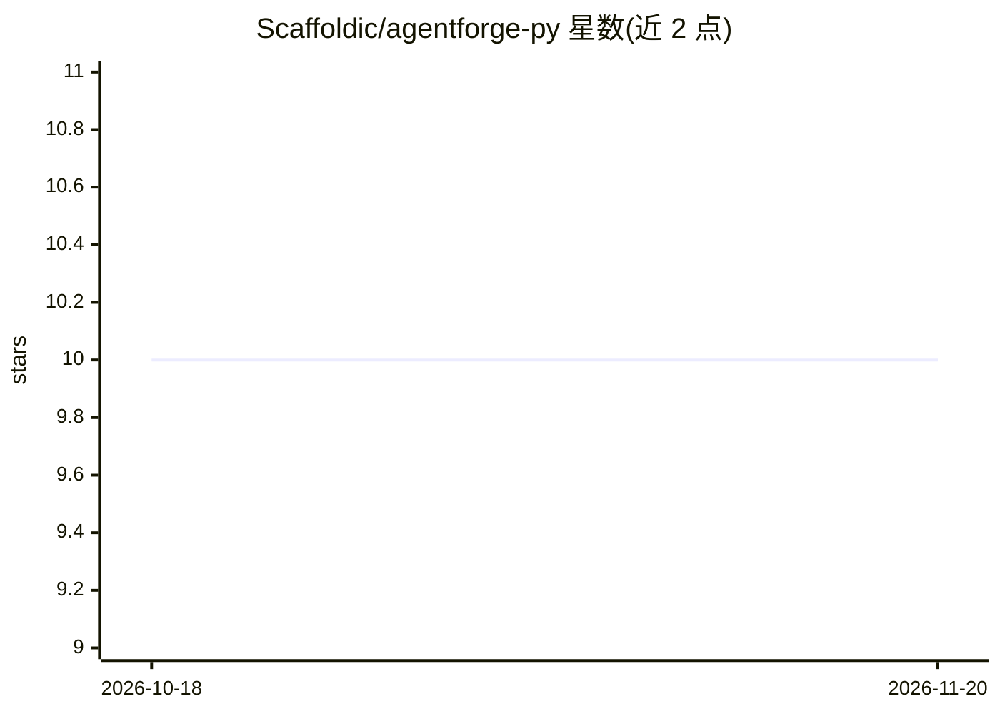

# Scaffoldic/agentforge-py

⭐ 10 · Python · Apache-2.0 · 推送 2026-09-19 · [GitHub](https://github.com/Scaffoldic/agentforge-py) · [官网](https://pypi.org/project/agentforge-py/) · 个人维护

**为开发者提供配置化组装的 Python AI agent 生产框架**

contracts-first 的 Python agent 框架：核心约 30 个锁定 ABC 定义 agent 接口，LLM 供应商、记忆存储、可观测性、护栏、推理循环均为独立 PyPI 包，通过 YAML 一行配置切换而 agent 代码不变。内置成本护栏（超预算先失败）、OpenTelemetry 追踪、PII 脱敏、可复现评估，并提供 `agentforge new` 脚手架生成含 6 种模板的完整项目，附带面向 Claude Code/Cursor 等 AI 编码助手的运行手册。v0.2.x，单人维护。

## 筛选速览

| 维度 | 判定 | 备注 |
|---|---|---|
| AI 角色 | `ai-ecosystem` | LLM/agent 周边工具 |
| 许可风险 | `permissive` | Apache-2.0 |
| 部署形态 | `library` | 以包/库形式分发 |
| 模型依赖 | local-ok | 支持本地模型 |
| 硬件要求 | — | 无带数字的原话,不猜 |
| 安装摩擦 | `low` | 无编译、无系统依赖或容器化 |
| 成熟度 | `idea` | |

## 能力要点

- ~30 个版本锁定契约（ABC），破坏性变更触发主版本号
- LLM/记忆/护栏/推理循环均为独立 PyPI 包，YAML 一行切换
- 内置成本护栏、OpenTelemetry 追踪、PII 脱敏与 CI 评估门
- 脚手架附带 6 种模板及面向 AI 编码助手的任务运行手册

## 适用场景

- 从零搭建可运行的 agent 项目并离线跑通完整循环
- 不改动 agent 代码的前提下切换 LLM 供应商或推理循环
- 为 agent 建立成本上限、追踪与 PII 脱敏的生产管线
- 将 prompt/模型变更转化为可复现的 CI 评估门禁

## 场景标签

`Agent 框架` · 领域:Agent 开发

## 证据(README 行号)

> L3: **An AI-agent framework that behaves like infrastructure, not a demo you
> L125: AgentForge is a **contracts-first** framework: ~30 locked ABCs in

## 星数曲线

2026-10-18 10 → 2026-11-20 10（+0）

---
*卡片 v1 · prompt 1.4 · 生成 2026-11-20 · 置信度 high · 依据 README sha `bd561a3f0db3` · [字段定义](../../DATASET.md)*
