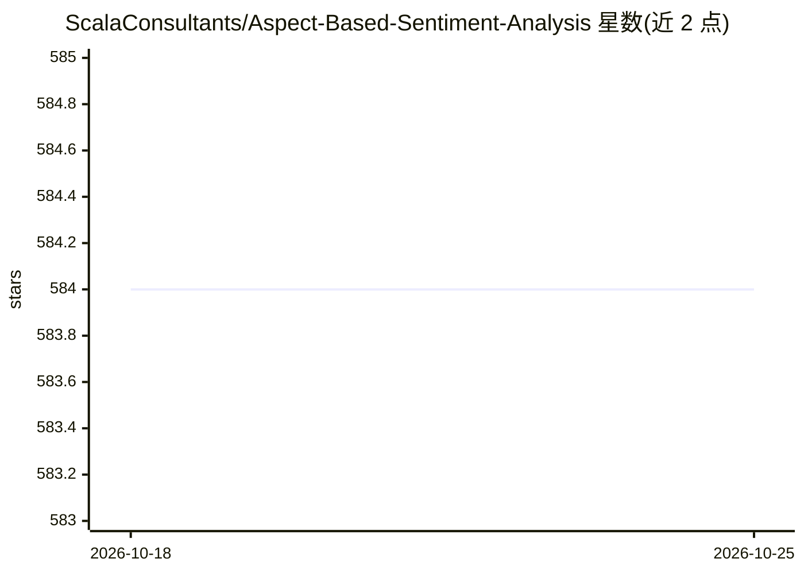

# ScalaConsultants/Aspect-Based-Sentiment-Analysis

⭐ 584 · Python · Apache-2.0 · 推送 2026-09-07 · [GitHub](https://github.com/ScalaConsultants/Aspect-Based-Sentiment-Analysis) · 组织维护

**基于 Transformer 的方面级情感分析 Python 包，附带预测解释**

面向 NLP 开发者的方面级情感分析（ABSA）工具包：对长文本按给定多个方面分别分类情感，基于 TensorFlow 的 Transformer 架构。核心机制是 pipeline 中的 professor 组件监督模型预测，pattern recognizer 基于 self-attention 值生成近似的决策解释，并可否决可疑预测。提供餐厅/笔记本两个领域预训练模型（SemEval 2014 数据集），文档说明注意力解释无因果关系链的限制。

## 筛选速览

| 维度 | 判定 | 备注 |
|---|---|---|
| AI 角色 | `ai-native` | 本体是模型或模型工具 |
| 许可风险 | `permissive` | Apache-2.0 |
| 部署形态 | `library` | 以包/库形式分发 |
| 模型依赖 | — | README 未给出锁定关系 |
| 硬件要求 | — | 无带数字的原话,不猜 |
| 安装摩擦 | `low` | 无编译、无系统依赖或容器化 |
| 成熟度 | — | 结构信号不足 |

## 能力要点

- 对长文本按多方面进行情感分类
- professor 组件监督并可否决可疑的模型预测
- pattern recognizer 基于 self-attention 生成近似决策解释
- 提供餐厅与笔记本两个领域的预训练模型

## 适用场景

- 分析评论文本中不同方面（如价格、服务）的情感
- 构建可解释的 ABSA 模型并查看预测依据
- 在 SemEval 2014 数据集上复现评估结果

## 场景标签

 · 领域:NLP/情感分析

## 证据(README 行号)

> L3: The task is to classify the sentiment of potentially long texts for several aspects.
> L40: nlp = absa.load()

## 星数曲线

2026-10-18 584 → 2026-10-25 584（+0）

---
*卡片 v1 · prompt 1.4 · 生成 2026-10-21 · 置信度 high · 依据 README sha `3b262b863d9b` · [字段定义](../../DATASET.md)*
