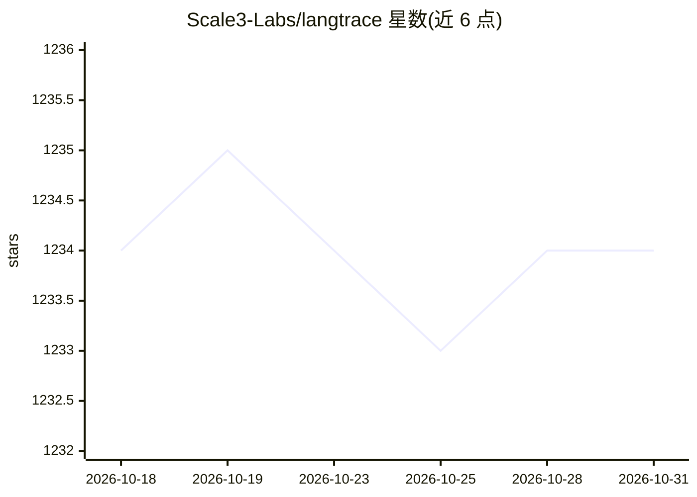

# Scale3-Labs/langtrace

⭐ 1,234 · TypeScript · AGPL-3.0 · 推送 2025-11-17 · [GitHub](https://github.com/Scale3-Labs/langtrace) · [官网](https://langtrace.ai) · 组织维护

**面向 LLM 应用的开源可观测性工具：捕获追踪、指标与调试数据**

基于 OpenTelemetry 标准的 LLM 应用可观测性软件：通过 TypeScript/Python SDK 自动采集 LLM API 调用、向量数据库操作与框架使用的追踪数据，提供延迟、成本、用量分析与调试视图。支持托管 SaaS（langtrace.ai）与自托管两种方式；自托管需以 Docker Compose 运行 Next.js 应用、Postgres 与 Clickhouse 三个服务，且自托管 OSS 版不收集遥测数据。应用本体采用 AGPL 3.0 许可，SDK 为 Apache 2.0。

## 筛选速览

| 维度 | 判定 | 备注 |
|---|---|---|
| AI 角色 | `ai-ecosystem` | LLM/agent 周边工具 |
| 许可风险 | `viral` | AGPL-3.0 |
| 部署形态 | `self-host` | docker 或自建部署 |
| 模型依赖 | local-ok | 支持本地模型 |
| 硬件要求 | — | 无带数字的原话,不猜 |
| 安装摩擦 | `low` | 无编译、无系统依赖或容器化 |
| 成熟度 | — | 结构信号不足 |

## 能力要点

- 基于 OpenTelemetry 标准生成追踪数据，语义约定仍在开发中
- SDK 自动采集 10 家 LLM 提供商、14 个框架、7 种向量数据库的追踪
- 支持自托管（Docker Compose 运行 Next.js + Postgres + Clickhouse），数据不出本机
- 提供 TypeScript 与 Python SDK，AGPL 3.0（应用）/ Apache 2.0（SDK）双许可结构

## 适用场景

- 为生产环境的 LLM 应用做调用追踪与调试
- 分析 LLM 应用的延迟、成本与用量模式
- 在自有基础设施上部署满足数据合规要求的可观测性平台

## 场景标签

`LLM 可观测性` · 领域:评测与运维

## 证据(README 行号)

> L21: Langtrace is an open source observability software which lets you capture, debug and analyze traces and metrics fro
> L27: - 📊 **Open Telemetry Support**: Built on OTEL standards for comprehensive tracing
> L160: Langtrace automatically captures traces from the following vendors and frameworks:

## 星数曲线

2026-10-18 1,234 → 2026-10-31 1,234（+0）

---
*卡片 v1 · prompt 1.4 · 生成 2026-10-21 · 置信度 high · 依据 README sha `fba5c7aafcc9` · [字段定义](../../DATASET.md)*
