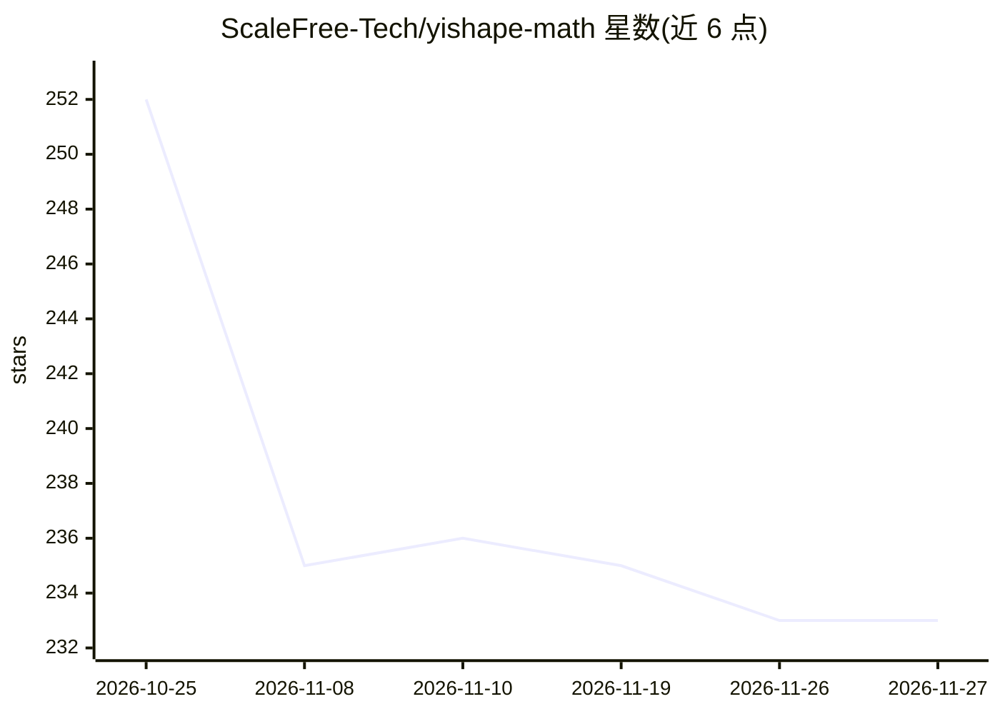

# ScaleFree-Tech/yishape-math

⭐ 233 · Java · Apache-2.0 · 推送 2026-10-22 · [GitHub](https://github.com/ScaleFree-Tech/yishape-math) · 组织维护 · 中文 README

**Java 数学计算库：为开发者提供 NumPy 风格运算与 ML**

基于 Java 的数学计算库，API 设计仿照 Python NumPy/SciPy，提供向量与矩阵运算、DataFrame、统计推断、数据可视化、机器学习算法、优化与线性规划、自动微分、多准则决策、距离度量学习、信号处理、时间序列与向量索引共十个门面类入口。性能方面提供基于 Java Vector API 的 SIMD 支持及 Rust 原生后端加速层。库来源于博士期间度量学习优化代码，曾用于电子科技大学课程实验教学，并作为 YiShape 向量数据库与深度学习项目的底层计算引擎。

## 筛选速览

| 维度 | 判定 | 备注 |
|---|---|---|
| AI 角色 | `ai-native` | 本体是模型或模型工具 |
| 许可风险 | `permissive` | Apache-2.0 |
| 部署形态 | `None` |  |
| 模型依赖 | — | README 未给出锁定关系 |
| 硬件要求 | — | 无带数字的原话,不猜 |
| 安装摩擦 | `medium` | 含编译或系统依赖之一 |
| 成熟度 | — | 结构信号不足 |

## 能力要点

- 十个门面类（Linalg/ML/AD/Stats 等）覆盖科学计算与 ML 主要功能
- 支持反向/前向/混合模式自动微分及 Neural ODE
- SIMD 与 Rust 原生后端双路径加速，API 不变可切换
- 内置 SVG 绘图后端，可选 JavaFX/ECharts 扩展

## 适用场景

- 在 Java 项目中做矩阵运算与统计分析而不引入 Python
- 为分类、聚类、降维等任务调用内置机器学习算法
- 求解线性规划与多目标优化问题
- 构建时间序列预测与信号分析流程

## 场景标签

 · 领域:科学计算/机器学习基础库

## 证据(README 行号)

> L11: **YiShape-Math** is a Java-based mathematical computing library that provides core functionalities including vector

## 星数曲线

2026-10-25 252 → 2026-11-27 233（-19）

---
*卡片 v1 · prompt 1.4 · 生成 2026-11-25 · 置信度 high · 依据 README sha `3e3a63d79e8a` · [字段定义](../../DATASET.md)*
