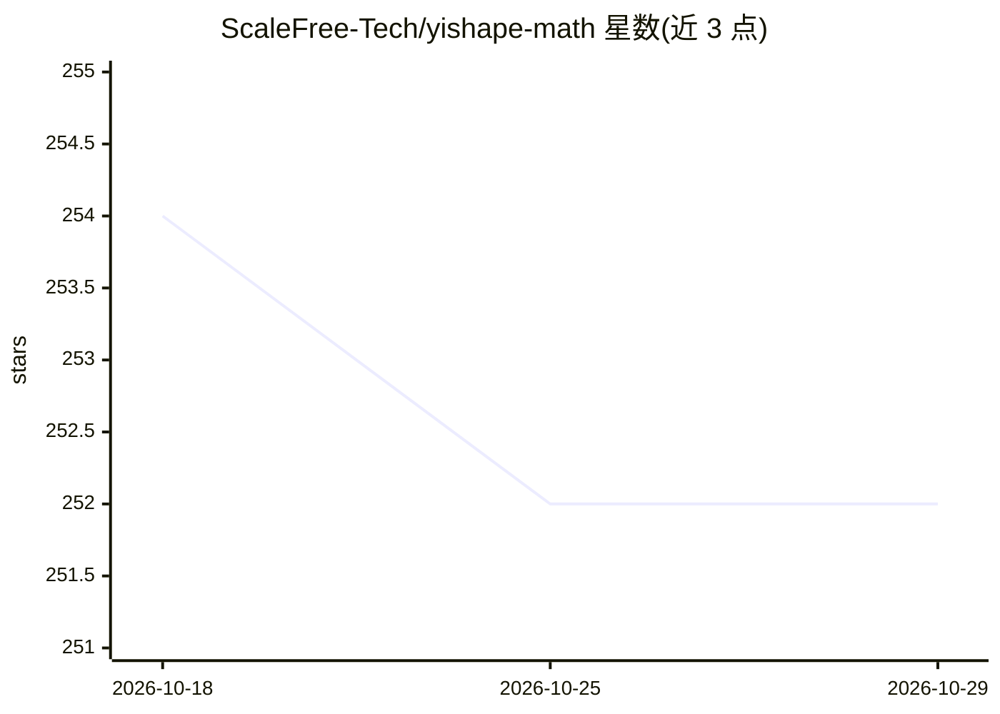

# ScaleFree-Tech/yishape-math

⭐ 252 · Java · Apache-2.0 · 推送 2026-10-22 · [GitHub](https://github.com/ScaleFree-Tech/yishape-math) · 组织维护 · 中文 README

**Java 科学计算与机器学习库，提供类 NumPy/SciPy 的数值功能**

面向 JVM 的数学计算库，以十个门面类（Linalg/Stats/ML/AD/Signals 等）通过流式 API 提供向量矩阵运算、DataFrame 与 CSV 读写、统计与假设检验、机器学习（回归/分类/聚类/降维）、反向/前向/混合模式自动微分、优化与线性规划、多准则决策、距离度量学习、信号处理、时间序列、可视化（SVG/JavaFX/ECharts 后端）与向量索引。支持 Java Vector API 的 SIMD、经 FFM 调用 Rust 原生库（可选 HPC 扩展）与 GPU 着色器加速。要求 Java 25 与 Maven 3.6+，可经 GitHub Packages、源码构建或预编译 JAR 安装；源自 UESTC 距离度量学习博士研究并用于该校课程教学。

## 筛选速览

| 维度 | 判定 | 备注 |
|---|---|---|
| AI 角色 | `ai-native` | 本体是模型或模型工具 |
| 许可风险 | `permissive` | Apache-2.0 |
| 部署形态 | `None` |  |
| 模型依赖 | — | README 未给出锁定关系 |
| 硬件要求 | — | 无带数字的原话,不猜 |
| 安装摩擦 | `medium` | 含编译或系统依赖之一 |
| 成熟度 | — | 结构信号不足 |

## 能力要点

- 反向/前向/混合模式自动微分，支持 Hessian、Neural ODE、稀疏与复数求导
- 14+ 种经典距离度量学习算法及自研 DDML 算法（INFORMS Journal on Computing 2024）
- SIMD 与 Rust 原生后端可选加速，HPC 与纯 Java 模式共享同一 API
- 三种绘图后端（内置 SVG、可选 JavaFX/ECharts）与 hnsw/LSH/KD-Tree 向量索引

## 适用场景

- 在 Java 项目中完成统计、优化、时间序列等数值计算
- 教学场景下的统计分析与机器学习建模实践
- 构建需要自动微分与距离度量学习的算法原型

## 场景标签

 · 领域:科学计算/数学库

## 证据(README 行号)

> L11: **YiShape-Math** is a Java-based mathematical computing library that provides core functionalities including vector
> L63: - **Reverse-mode AD**: `AD.vector()` creates variables, `loss.backward()` auto-propagates gradients, 40+ ops (advan
> L81: - **Proprietary DDML Algorithm**: Regularized diagonal distance metric learning published in INFORMS Journal on Com

## 星数曲线

2026-10-18 254 → 2026-10-29 252（-2）

---
*卡片 v1 · prompt 1.4 · 生成 2026-10-22 · 置信度 high · 依据 README sha `82f6ef24c7e3` · [字段定义](../../DATASET.md)*
