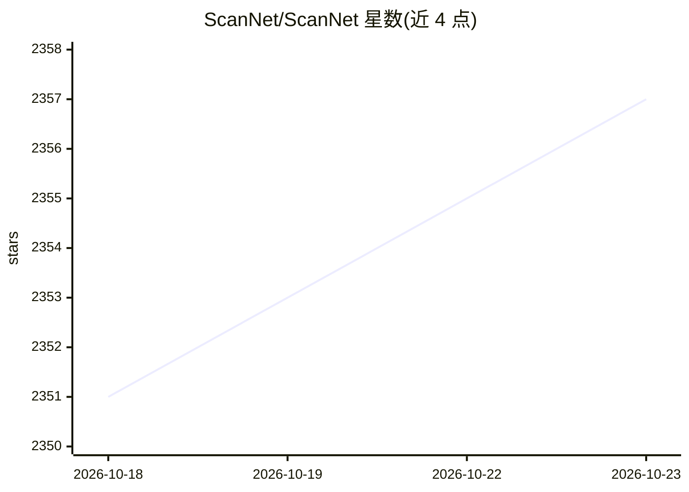

# ScanNet/ScanNet

⭐ 2,357 · C · NOASSERTION · 推送 2025-11-03 · [GitHub](https://github.com/ScanNet/ScanNet) · [官网](http://www.scan-net.org/) · 组织维护

**室内场景 RGB-D 3D 数据集：250 万视图、1500+ 扫描及语义标注**

面向 3D 场景理解研究的 RGB-D 视频数据集：收录 1500 余次室内扫描、约 250 万视图，标注 3D 相机位姿、表面重建网格与实例级语义分割。数据按场景序列组织，提供 .sens 流、.ply 网格、分割与聚合标注等格式说明，并附 C++ 读取工具包、相机参数估计、网格分割代码、iPad 采集 App、数据处理服务器与标注流程工具。获取数据需以机构邮箱签署使用条款邮件申请；代码采用 MIT 许可，数据受 ScanNet Terms of Use 约束。另提供 3D 分类/检索、语义体素标注等基准任务与训练测试划分。

## 筛选速览

| 维度 | 判定 | 备注 |
|---|---|---|
| AI 角色 | `ai-knowledge` | 知识聚合/清单类 |
| 许可风险 | `none` | NOASSERTION |
| 部署形态 | `None` |  |
| 模型依赖 | — | README 未给出锁定关系 |
| 硬件要求 | — | 无带数字的原话,不猜 |
| 安装摩擦 | `low` | 无编译、无系统依赖或容器化 |
| 成熟度 | — | 结构信号不足 |

## 能力要点

- 1500+ 扫描、约 250 万 RGB-D 视图，含位姿、重建网格与实例级语义标注
- 提供 .sens 读取工具包（C++/Python 导出）与相机参数估计、网格分割代码
- 涵盖 iPad 采集 App、数据服务器、WebUI 管理与语义标注流程
- 提供 3D 分类/检索、语义体素基准任务及 NYUv2/ModelNet/ShapeNet/WordNet 标签映射

## 适用场景

- 作为 3D 语义分割、场景理解方法的训练评测数据集
- 获取带实例级语义标注的室内 RGB-D 序列与重建网格
- 复用其采集-处理-标注流水线搭建自己的 RGB-D 采集项目

## 场景标签

 · 领域:计算机视觉/3D 场景理解

## 证据(README 行号)

> L3: ScanNet is an RGB-D video dataset containing 2.5 million views in more than 1500 scans, annotated with 3D camera pos
> L85: We provide code for several scene understanding benchmarks on ScanNet:

## 星数曲线

2026-10-18 2,351 → 2026-10-23 2,357（+6）

---
*卡片 v1 · prompt 1.4 · 生成 2026-10-21 · 置信度 high · 依据 README sha `4202a18a83b2` · [字段定义](../../DATASET.md)*
