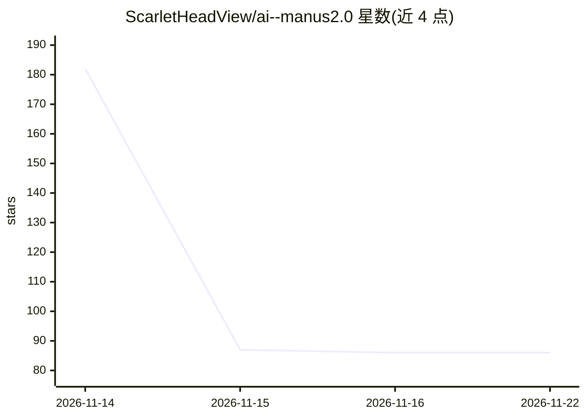

# ScarletHeadView/ai--manus2.0

⭐ 86 · Apache-2.0 · 推送 2026-11-15 · [GitHub](https://github.com/ScarletHeadView/ai--manus2.0) · 个人维护

**自主 AI Agent：代用户执行代码与控制浏览器完成任务**

Manus 是面向家庭、学习与轻量办公场景的自主 AI Agent：用户以自然语言下达指令，代理自行规划步骤，可编写并执行脚本、打开网页、填写表单、跨页面收集信息，并执行多步骤任务；脚本与浏览器操作可在同一流程中衔接。README 声明其定位于小规模任务而非企业平台。仅提供概要说明与硬件兼容表，未给出源码结构、模型接入方式或安装命令，仅提示 'Download Manus' 与兑换码字样，可获取性不明。

## 筛选速览

| 维度 | 判定 | 备注 |
|---|---|---|
| AI 角色 | `ai-native` | 本体是模型或模型工具 |
| 许可风险 | `permissive` | Apache-2.0 |
| 部署形态 | `None` |  |
| 模型依赖 | — | README 未给出锁定关系 |
| 硬件要求 | — | 无带数字的原话,不猜 |
| 安装摩擦 | `low` | 无编译、无系统依赖或容器化 |
| 成熟度 | — | 结构信号不足 |

## 能力要点

- 自主编写并执行脚本完成代码类任务
- 代理控制浏览器：导航页面、填写表单、收集信息
- 脚本与浏览器操作在同一任务流程中衔接
- 面向学习、家庭与轻量办公的小规模任务场景

## 适用场景

- 让学生整理研究笔记、跑小脚本与查资料
- 让代理代为完成查网页、填表单等重复性操作
- 远程工作者跨多个页面收集数据并汇总

## 场景标签

`浏览器自动化` `编码 Agent` · 领域:效率与自动化

## 证据(README 行号)

> L18: Manus is an autonomous AI agent designed to run code and control a browser on your behalf. Instead of acting like a

## 星数曲线

2026-11-14 182 → 2026-11-22 86（-96）

---
*卡片 v1 · prompt 1.4 · 生成 2026-11-17 · 置信度 low · 依据 README sha `637da4fbcded` · [字段定义](../../DATASET.md)*
