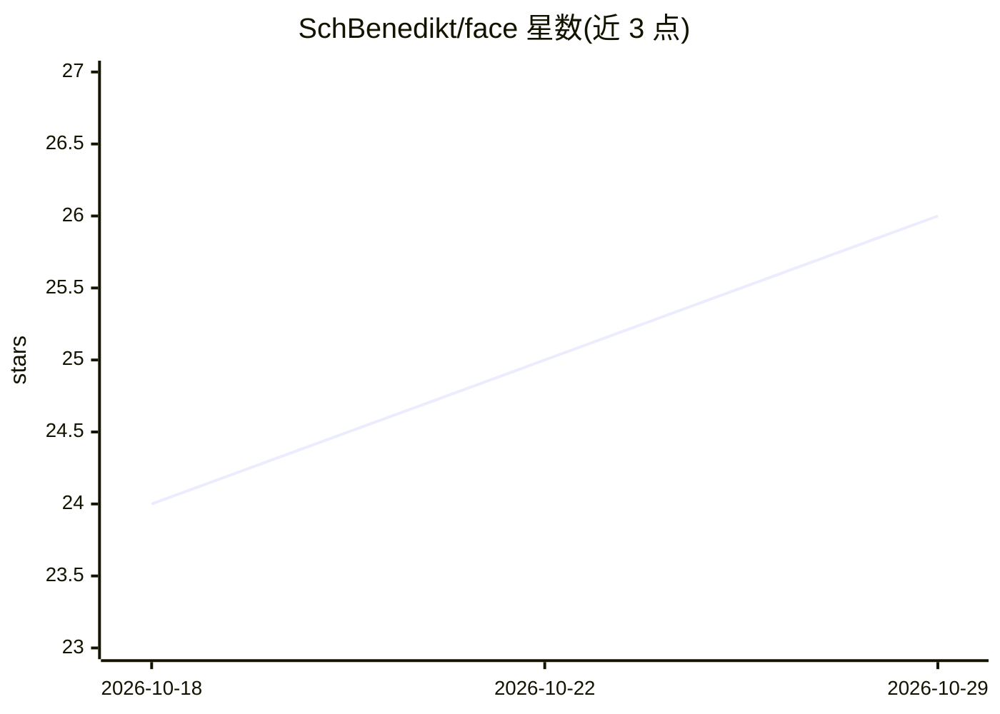

# SchBenedikt/face

⭐ 26 · Python · 推送 2025-12-06 · [GitHub](https://github.com/SchBenedikt/face) · [官网](https://dev.to/techtech/face-recognition-system-that-actually-works-453e) · 个人维护

**本地人脸检测与识别搜索系统，以图搜相似人脸**

基于 Python/Streamlit 的本地人脸识别搜索平台：组合 FaceNet512、ArcFace、VGG-Face、FaceNet 四个模型做嵌入提取，辅以自适应加权融合与多指标相似度计算，支持 OpenCV/CNN/MTCNN/RetinaFace 检测后端与三档处理模式。流程为网页抓取图片、批处理提取人脸嵌入存入 ChromaDB 向量库、去重清理后以 Streamlit 网页界面做相似人脸搜索，并输出年龄/性别/表情/种族分析。描述中自称 Pimeyes 的本地替代。要求 Python 3.11+，GPU 为可选项。

## 筛选速览

| 维度 | 判定 | 备注 |
|---|---|---|
| AI 角色 | `ai-native` | 本体是模型或模型工具 |
| 许可风险 | `none` | — |
| 部署形态 | `library` | 以包/库形式分发 |
| 模型依赖 | — | README 未给出锁定关系 |
| 硬件要求 | — | 无带数字的原话,不猜 |
| 安装摩擦 | `medium` | 含编译或系统依赖之一 |
| 成熟度 | — | 结构信号不足 |

## 能力要点

- 四模型集成嵌入提取（FaceNet512/ArcFace/VGG-Face/FaceNet）与自适应加权融合
- 相似人脸向量搜索，嵌入存储于 ChromaDB
- 四种检测后端与 ultra-fast/balanced/premium 三档处理模式
- 网页图片抓取脚本、去重清理与属性分析（年龄/性别/表情/种族）

## 适用场景

- 上传一张人脸照片在本地图片库中搜索相似人脸
- 批量抓取并处理网站图片建立可搜索的人脸库
- 计算机视觉教学与人脸识别算法实验

## 场景标签

`人脸识别` · 领域:感知与多模态

## 证据(README 行号)

> L31: - **🧠 Multi-Model AI**: Leverages DeepFace, InsightFace, and custom ensemble algorithms
> L48: - **Facial Recognition**: State-of-the-art embedding extraction using ensemble methods
> L278: 3. Stores embeddings in ChromaDB vector database

## 星数曲线

2026-10-18 24 → 2026-10-29 26（+2）

---
*卡片 v1 · prompt 1.4 · 生成 2026-10-27 · 置信度 mid · 依据 README sha `74fe1316f2a4` · [字段定义](../../DATASET.md)*
