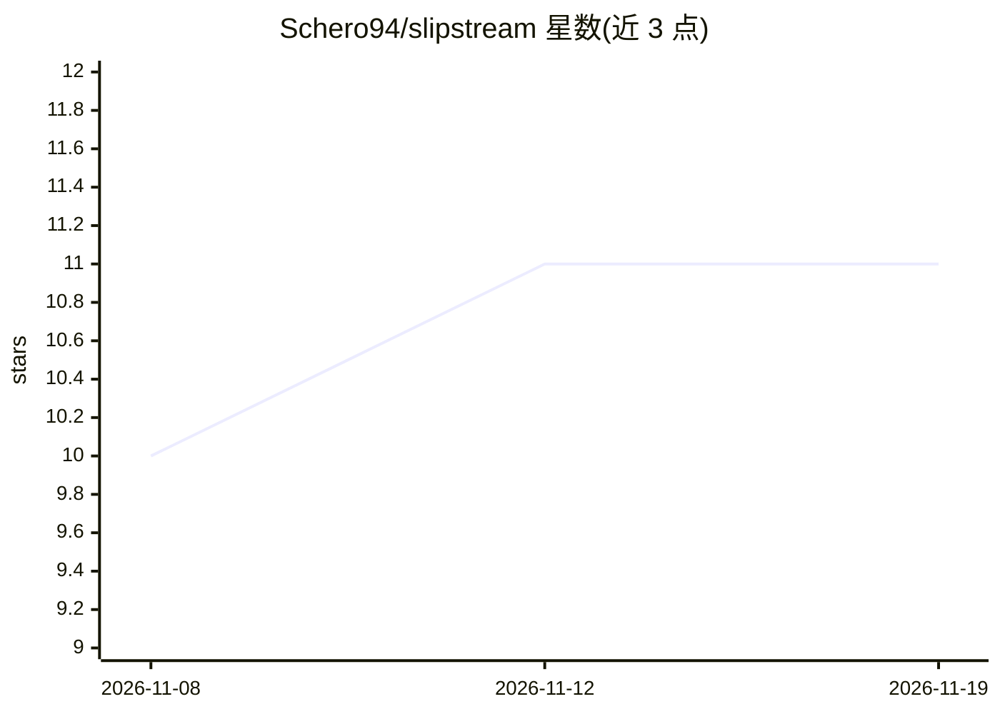

# Schero94/slipstream

⭐ 11 · Python · NOASSERTION · 推送 2026-08-17 · [GitHub](https://github.com/Schero94/slipstream) · [官网](https://schero94.github.io/slipstream/) · 个人维护

**从 SSD 流式加载 MoE 专家的 llama.cpp 分支，让 Mac 本地跑超 RAM 编码模型**

Slipstream 是 llama.cpp 的一个分支，将 MoE 专家权重放在 SSD 上按需流式读取，而非整模型载入内存；16–36 GB 内存的 Apple Silicon Mac 可运行 35B–480B 的编码模型。以自包含 macOS 应用（.dmg）发布，内嵌推理引擎与 PGRN 转换器，在本地 127.0.0.1:8080 提供 OpenAI 兼容 API；带内存健康门控拒绝会引发 swap 的缓存配置，支持 MTP/DFlash 投机解码，UI 有英德双语。引擎另可在 Linux 命令行构建运行，CUDA 未测试。

## 筛选速览

| 维度 | 判定 | 备注 |
|---|---|---|
| AI 角色 | `ai-ecosystem` | LLM/agent 周边工具 |
| 许可风险 | `none` | NOASSERTION |
| 部署形态 | `desktop` | 安装包/桌面程序 |
| 模型依赖 | local-ok | 支持本地模型 |
| 硬件要求 | — | 无带数字的原话,不猜 |
| 安装摩擦 | `medium` | 含编译或系统依赖之一 |
| 成熟度 | `idea` | |

## 能力要点

- 从 SSD 流式读取 MoE 专家权重，35B–480B 模型可在 16–36 GB 内存的 Apple Silicon 上运行
- 捆绑本地引擎的 macOS 自包含应用，在 127.0.0.1:8080 提供 OpenAI 兼容 API
- 按层分区的 CLOCK-LRU-K 缓存与内存健康门控，拒绝会导致 swap 的缓存配置
- 支持 MTP/DFlash 投机解码与可恢复的 PGRN 模型转换（带 CRC 日志）

## 适用场景

- 在内存不够装下大模型的 Mac 上本地运行大型 MoE 编码模型
- 为 Kilo Code、Cline、Cursor 等编码助手提供本地 OpenAI 兼容推理端点
- 在本地启动嵌入服务与 Qdrant 向量库做代码库索引

## 场景标签

`推理引擎` · 领域:训练与推理

## 证据(README 行号)

> L7: Slipstream is a fork of llama.cpp that streams Mixture-of-Experts (MoE) expert weights off your SSD instead of loadi
> L55: 5. Click Start. Once the pill turns green you're serving an OpenAI-compatible API on `127.0.0.1:8080`.

## 星数曲线

2026-11-08 10 → 2026-11-19 11（+1）

---
*卡片 v1 · prompt 1.4 · 生成 2026-11-18 · 置信度 high · 依据 README sha `465f434a6d86` · [字段定义](../../DATASET.md)*
