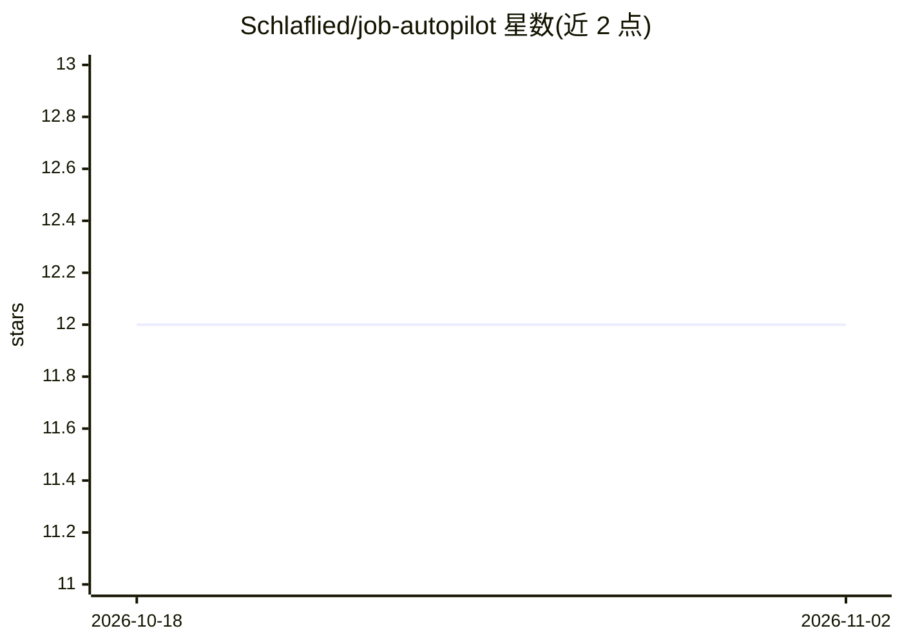

# Schlaflied/job-autopilot

⭐ 12 · Python · GPL-3.0 · 推送 2026-01-28 · [GitHub](https://github.com/Schlaflied/job-autopilot) · 个人维护

**求职者用的 AI 求职自动化系统：抓岗、改简历、LinkedIn 外联**

面向求职者（尤其 EdTech、L&D、AI 产品与自动化领域）的求职流程自动化应用：通过 Apify 抓取 Indeed 职位并用 GPT-4o 按 0-10 分打分归类，基于 GPT-4o 针对职位描述优化简历并给出 ATS 兼容分，通过 Chrome DevTools Protocol 控制本地 Chrome 做 LinkedIn 校友搜索与自动连接请求（带 10-20 秒限速），并生成冷邮件 Gmail 草稿。含 ContactRanker、ScamDetection、Personalization 三个 agent 与 ChromaDB 记忆层。需自备 OpenAI、Apify、Neon、Gmail API 凭据，月成本约 5-10 美元。

## 筛选速览

| 维度 | 判定 | 备注 |
|---|---|---|
| AI 角色 | `ai-native` | 本体是模型或模型工具 |
| 许可风险 | `viral` | GPL-3.0 |
| 部署形态 | `desktop` | 安装包/桌面程序 |
| 模型依赖 | — | README 未给出锁定关系 |
| 硬件要求 | — | 无带数字的原话,不猜 |
| 安装摩擦 | `low` | 无编译、无系统依赖或容器化 |
| 成熟度 | — | 结构信号不足 |

## 能力要点

- GPT-4o 驱动的职位打分与逐职位简历优化（ATS 兼容评分）
- Chrome DevTools Protocol 控制 Chrome 做 LinkedIn 校友搜索与限速自动连接
- ContactRanker/ScamDetection/Personalization 三个 AI agent
- ChromaDB 向量记忆层学习成功外联消息

## 适用场景

- 自动抓取并筛选 Indeed 职位、按匹配度排序
- 针对每个职位生成定制化 ATS 友好简历
- 搜索校友并发送个性化 LinkedIn 连接请求和冷邮件

## 场景标签

`工作流自动化` `网页抓取` `浏览器自动化` `AI 写作` · 领域:效率与自动化

## 证据(README 行号)

> L7: **AI-powered job application automation system** that streamlines your job search workflow using GPT-4o, automated s
> L16: - 🤖 **AI-Powered Job Scoring** (0-10 rating based on your profile)
> L27: - 🎯 **Job-Tailored Resumes**: AI optimizes resume for each job description

## 星数曲线

2026-10-18 12 → 2026-11-02 12（+0）

---
*卡片 v1 · prompt 1.4 · 生成 2026-11-01 · 置信度 high · 依据 README sha `c3bd5d010d4f` · [字段定义](../../DATASET.md)*
