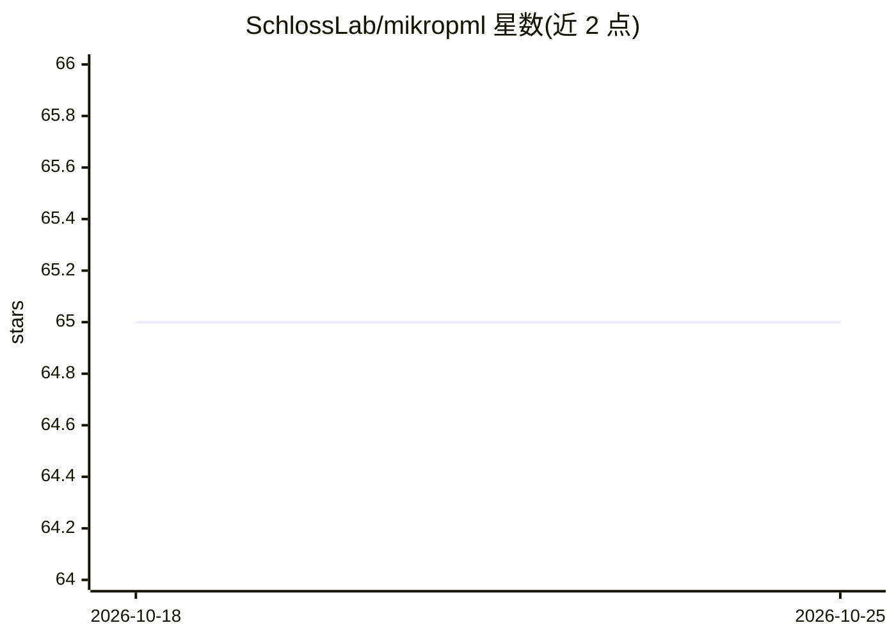

# SchlossLab/mikropml

⭐ 65 · R · NOASSERTION · 推送 2026-08-29 · [GitHub](https://github.com/SchlossLab/mikropml) · [官网](http://www.schlosslab.org/mikropml) · 组织维护

**面向监督学习的 R 语言机器学习流水线工具包**

R 包，为分类与回归问题构建机器学习模型，实现 Topçuoğlu 等（2020）描述的 ML 流水线，对数据预处理、超参数调优、交叉验证、测试、模型评估与解释步骤提供默认合理配置。底层依赖 caret、glmnet、randomForest、xgboost 等建模库。可从 CRAN、r-universe、GitHub 安装，亦提供含全部依赖的容器镜像与配套 Snakemake 工作流（可本地或 HPC 运行）。最初面向微生物组分类问题实现，后扩展到通用场景。

## 筛选速览

| 维度 | 判定 | 备注 |
|---|---|---|
| AI 角色 | `ai-native` | 本体是模型或模型工具 |
| 许可风险 | `none` | NOASSERTION |
| 部署形态 | `self-host` | docker 或自建部署 |
| 模型依赖 | — | README 未给出锁定关系 |
| 硬件要求 | — | 无带数字的原话,不猜 |
| 安装摩擦 | `low` | 无编译、无系统依赖或容器化 |
| 成熟度 | — | 结构信号不足 |

## 能力要点

- 一条函数完成预处理、调参、交叉验证、评估的完整流水线
- 支持多种模型（glmnet、randomForest、xgboost、rpart、SVM 等）
- 提供含全部依赖的容器镜像与 Snakemake 工作流
- 发表于 JOSS，有论文与教程视频

## 适用场景

- 在 R 中快速跑通带交叉验证与调参的分类/回归分析
- 微生物组数据的分类建模
- 通过 Snakemake 在本地或 HPC 上做可复现的 ML 分析

## 场景标签

`MLOps` · 领域:训练与推理

## 证据(README 行号)

> L16: An interface to build machine learning models for classification and
> L17: regression problems. `mikropml` implements the ML pipeline described by

## 星数曲线

2026-10-18 65 → 2026-10-25 65（+0）

---
*卡片 v1 · prompt 1.4 · 生成 2026-10-24 · 置信度 high · 依据 README sha `efcac79aeb3f` · [字段定义](../../DATASET.md)*
