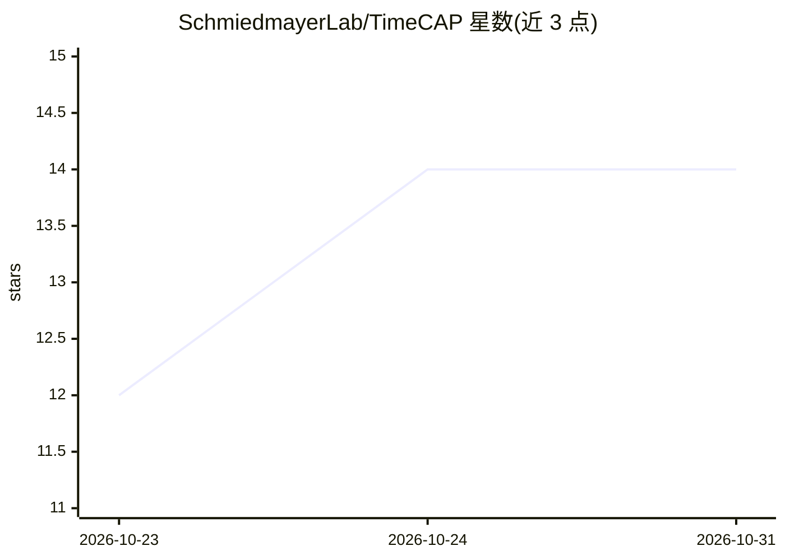

# SchmiedmayerLab/TimeCAP

⭐ 14 · Python · MIT · 推送 2026-10-14 · [GitHub](https://github.com/SchmiedmayerLab/TimeCAP) · 组织维护

**把多通道传感器记录转为带描述文本的时序数据集管线**

数据集无关的管线：从 HuggingFace 数据集读取多通道传感器记录，经 Transformer 映射为内部 Recording 结构，再由 Annotator 运行四个 caption 提取器（统计、结构、语义、跨通道），以模板驱动方式生成确定性的语言描述文本，输出 Arrow 分片。参考实现面向 MyHeartCounts 可穿戴数据（日/周分辨率），另支持 WESAD 数据集路径；新增数据源只需编写 Dataset、Transformer 与 ChannelConfig。提供导出脚本、Slurm 分片并行、Python 库接口与交互式浏览器，产出的 MHCap/WESADCap 数据集见 DATASET.md。MIT 许可，由 Schmiedmayer Lab（研究实验室）维护。

## 筛选速览

| 维度 | 判定 | 备注 |
|---|---|---|
| AI 角色 | `ai-ecosystem` | LLM/agent 周边工具 |
| 许可风险 | `permissive` | MIT |
| 部署形态 | `library` | 以包/库形式分发 |
| 模型依赖 | — | README 未给出锁定关系 |
| 硬件要求 | — | 无带数字的原话,不猜 |
| 安装摩擦 | `low` | 无编译、无系统依赖或容器化 |
| 成熟度 | — | 结构信号不足 |

## 能力要点

- 四个 caption 提取器：统计/结构/语义/跨通道
- 模板驱动的确定性 caption 生成，变体由行派生种子选取
- 新增数据源仅需 Dataset+Transformer+ChannelConfig，不改核心管线
- Slurm 分片并行导出与逐行交互式 explorer

## 适用场景

- 把可穿戴传感器原始记录转成 LLM 可用的描述文本数据集
- 研究项目中复用同一管线处理不同传感器数据集（MHC、WESAD）
- 逐行检查时序信号与检测事件的对应关系

## 场景标签

`科研工具` · 领域:学习与行业

## 证据(README 行号)

> L7: Dataset-agnostic pipeline that turns raw multi-channel sensor recordings into
> L8: language-model-ready captions. The current reference implementation targets the

## 星数曲线

2026-10-23 12 → 2026-10-31 14（+2）

---
*卡片 v1 · prompt 1.4 · 生成 2026-10-31 · 置信度 mid · 依据 README sha `becf2f3e13da` · [字段定义](../../DATASET.md)*
